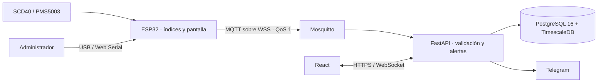

# AIRA · Monitoreo de calidad de aire interior en recintos universitarios

AIRA registra el ambiente de salas universitarias con un ESP32, presenta índices y mediciones actuales en una aplicación web y entrega avisos según los permisos del usuario. El nodo utiliza SCD40 (CO₂, temperatura y humedad), PMS5003 (PM₂.₅ y PM₁₀) y una pantalla ST7789. Calcula ICAI, ICT e ICG en ventanas de cinco minutos y envía resultados por MQTT/WSS con QoS 1. FastAPI valida y almacena la telemetría en PostgreSQL/TimescaleDB; React muestra el estado y el bot de Telegram ofrece consultas y avisos.

Los nombres, dominios y direcciones de los ejemplos son ficticios; cada instalación debe aportar su propia configuración privada.

El código se distribuye bajo la [licencia MIT](LICENSE).

## Cómo empezar

1. Revisa los [requisitos y el arranque local](docs/instalacion-local.md) para preparar una base **nueva**, crear el primer administrador e iniciar API y web. El broker y el hardware se configuran después, cuando necesites probar la ingesta real.
2. Para un clúster, sigue el [despliegue Kubernetes](k8s/README.md). Los manifiestos usan el namespace genérico `aira` y el dominio de ejemplo `aira.example.org`; adapta DNS, TLS, almacenamiento y Secret a tu instalación.
3. Para cablear, compilar y aprovisionar una placa, sigue la [guía ESP32](esp32_nodo_aira/README.md).

La instalación local documentada permite probar interfaz, usuarios y jerarquía de espacios. La medición de extremo a extremo requiere además broker configurado, firmware compilado, sensores y una red disponible para el nodo.

## Arquitectura y datos

El ESP32 conserva ventanas pendientes en LittleFS y las retransmite tras recuperar la conexión. La [arquitectura general y la secuencia de telemetría](docs/arquitectura/README.md) abarcan varios componentes; cada diagrama específico está junto a su código. Los índices se calculan en el nodo y la plataforma los conserva, sin volver a calcularlos en el frontend.

## Componentes

| Ubicación | Guía y responsabilidad |
| --- | --- |
| [api/](api/README.md) | Autenticación, permisos, ingesta, consultas, alertas, firmware y Telegram. |
| [web/](web/README.md) | Dashboard React, administración, actualización en vivo y flasheo Web Serial. |
| [esp32_nodo_aira/](esp32_nodo_aira/README.md) | Firmware, cableado KiCad, pantalla y conectividad. |
| [contenido/base de datos/](contenido/base%20de%20datos/README_BD.md) | Esquema inicial, modelo ER y manejo de datos. |
| [k8s/](k8s/README.md) | Despliegue institucional y migraciones SQL. |
| [mosquitto/](mosquitto/README.md) | Broker y diferencias entre configuración local y Kubernetes. |
| [scripts/](scripts/README.md) | Preparación, generación de ConfigMaps y comprobaciones. |
| [contenido/](contenido/README.md) | Especificaciones y documentos de diseño de etapas anteriores. |
| [docs/](docs/README.md) | Instalación y diagramas transversales. |

## Versiones utilizadas

El contenedor del API usa Python 3.12 y sus paquetes están fijados en `api/requirements.txt`. La compilación web usa Node.js 20, React 18 y Vite 5; `web/package-lock.json` fija las dependencias instaladas. El esquema requiere PostgreSQL 16 con TimescaleDB. Los manifiestos usan Mosquitto 2.0 y el firmware se trabajó con Arduino-ESP32 core 3.3.12 y bibliotecas Adafruit GFX/ST7789. Consulta los archivos de dependencias antes de actualizar versiones; algunas imágenes de Kubernetes todavía usan tags móviles.

## Roles y alcance

El invitado entra sin credenciales y solo ve el estado actual de los espacios visibles. ADMIN administra lugares, nodos, usuarios y firmware; ANALISTA consulta información histórica y exportaciones dentro de su alcance; VIEWER consulta el estado permitido. El servidor comprueba los permisos aunque un control de la interfaz no esté visible. Telegram se vincula mediante un chat privado y respeta el alcance del usuario. La [guía del API](api/README.md) indica dónde comprobar el contrato actual (`/docs`).

## Desarrollo y publicación

`main` contiene los componentes integrados. Las ramas de trabajo son cortas y se nombran por cambio, por ejemplo `feature/firmware-pantalla`, `feature/web-filtros`, `feature/api-alertas`, `feature/database-indices`, `feature/infra-mqtt` o `docs/instalacion`. Una mejora que afecta API y web se mantiene en una sola rama para poder revisarla completa. Antes de integrar: ejecuta las comprobaciones del componente, revisa el diff y pasa `python scripts/check_publication.py` con los archivos preparados en Git.

No incluyas nombres de personas, rutas de equipos, dominios internos, MAC o SSID reales, contraseñas, tokens, credenciales de nodos, `secrets.h`, kubeconfig, certificados privados, firmware compilado ni mediciones reales. [`.gitignore`](.gitignore) es una barrera adicional, no sustituye la revisión. La base de datos real no está en el repositorio: se versionan esquema y migraciones, nunca respaldos con datos personales u operativos. Los ejemplos usan identificadores ficticios y el dominio reservado `example.org`.

## Límites conocidos

La aplicación Kubernetes de referencia usa un `emptyDir` para binarios de firmware: se pierde su contenido al recrear el Pod. Cambia a almacenamiento persistente antes de depender de esos binarios. La imagen TimescaleDB usa `latest-pg16` y Nginx usa `alpine`; para reproducibilidad de producción se deben fijar versiones o digests comprobados. El SQL inicial contiene varias evoluciones que también aparecen en migraciones históricas; en una base nueva **no se ejecutan todas las migraciones a ciegas**. Los documentos de etapas anteriores describen decisiones históricas y pueden diferir del código vigente.
