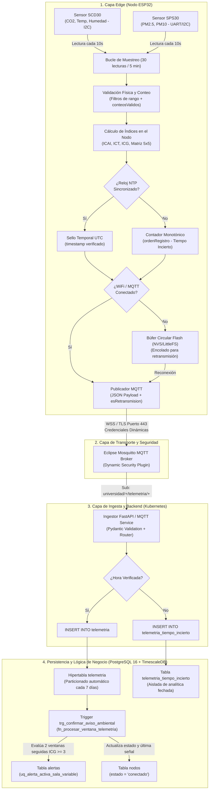
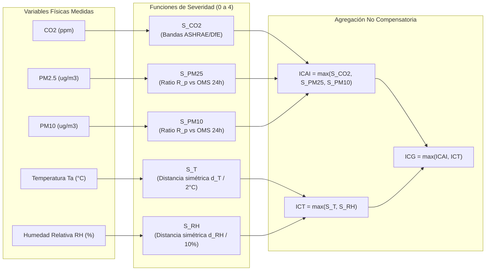

# Arquitectura del Flujo de Datos IoT y Fundamentación de Base de Datos: Del Sensor ESP32 a TimescaleDB

---

## 1. Resumen Ejecutivo y Diagrama de Arquitectura End-to-End

El sistema implementa una arquitectura ciberfísica (CPS) distribuida de tres capas (*Edge*, *Fog/Transport*, *Cloud/Platform*) para el monitoreo continuo de Calidad del Aire Interior (CAI) y Condición Termohigrométrica en recintos universitarios. 

El siguiente diagrama detalla la ruta crítica de los datos, desde la transducción física hasta su almacenamiento relacional y temporal:



---

## 2. Fase 1: Ciclo de Vida del Dato en el ESP32 (*Edge Computing*)

### 2.1. Transducción y Muestreo Físico
El nodo terminal está basado en un microcontrolador **ESP32-WROOM-32** (SoC dual-core Tensilica Xtensa LX6 a 240 MHz). El dispositivo interactúa con dos sensores calibrados de grado profesional:
1. **Sensirion SCD30:** Sensor de Dióxido de Carbono ($\text{CO}_2$) por Infrarrojo No Dispersivo (NDIR) con compensación térmica y de presión integrada, junto con medición de Temperatura ($T$) y Humedad Relativa ($\text{HR}$). Interfaz mediante bus $\text{I}^2\text{C}$ (Fast-mode, 400 kHz).
2. **Sensirion SPS30:** Sensor de Material Particulado ($\text{PM}_{2.5}$ y $\text{PM}_{10}$) basado en dispersión láser (*laser scattering*) con sistema de autolimpieza por ventilador. Interfaz mediante $\text{UART}$ o $\text{I}^2\text{C}$.

### 2.2. Ventana de Agregación Quinqueminutal (5 minutos)
En lugar de saturar el enlace de red enviando ráfagas continuas de mediciones instantáneas:
* **Frecuencia de lectura:** Cada $t_s = 10\text{ segundos}$, una tarea periódica de FreeRTOS sondea los registros de ambos sensores.
* **Tamaño teórico de la ventana:** En una ventana temporal de $T = 300\text{ segundos}$ (5 minutos), se capturan $N = 30\text{ muestras}$.
* **Filtros de validez física:** Cada muestra discreta se somete a validación de límites:
  $$0 \le \text{CO}_2 \le 40000\text{ ppm},\quad \text{PM}_{2.5} \ge 0,\quad \text{PM}_{10} \ge 0,\quad -20^\circ\text{C} \le T \le 60^\circ\text{C},\quad 0\% \le \text{HR} \le 100\%$$
* **Conteos válidos (`conteosValidos`):** Se contabiliza de forma independiente cuántas muestras útiles aportó cada sensor en el período (e.g., `{"co2": 30, "pm25": 30, "pm10": 30, "temperatura": 30, "humedad": 30}`). Si ocurren fallos en el bus $\text{I}^2\text{C}$, el conteo respectivo disminuye.
* **Cálculo de medias físicas:** Se obtienen las medias aritméticas de las lecturas válidas para cada variable física.

### 2.3. Evaluación de Índices en el Microcontrolador
Para reducir drásticamente la latencia de respuesta y descentralizar el cómputo, el firmware del ESP32 ejecuta la lógica normativa localmente:
1. **Subíndice ICAI (Calidad del Aire Interior):** Evalúa $\text{CO}_2$, $\text{PM}_{2.5}$ y $\text{PM}_{10}$ según funciones de piecewise linear mapping y normalización de umbrales en una escala discreta $0\dots4$ (*Óptimo, Precaución, Deficiente, Malo, Crítico*).
2. **Subíndice ICT (Condición Termohigrométrica):** Evalúa $T$ y $\text{HR}$ según el rango de confort ambiental y severidad.
3. **Índice Global ICG:** Se computa como la severidad máxima entre ambos dominios:
   $$\text{ICG} = \max(S_{\text{aire}}, S_{\text{termico}})$$
4. **Matriz de Diagnóstico 5x5 y Causalidad:** Se determinan las variables causales que empatan en el peor puntaje (`causasICG`), la coordenada de la matriz bidimensional (`celdaMatriz`: e.g. `'O'`, `'A1'..'A4'`, `'T1'..'T4'`, `'M1'..'M4'`) y las recomendaciones operativas directas.

### 2.4. Resiliencia Desconectada y Sincronización Horaria
* **Sincronización NTP:** El ESP32 mantiene sincronización de reloj mediante Network Time Protocol (NTP) contra servidores horarios UTC.
* **Sellado Temporal Verificado:** Si el reloj del ESP32 está sincronizado, la ventana se sella con el instante exacto UTC de su fin (`timestamp`).
* **Manejo de Desconexión (Tiempo Incierto):** Si el ESP32 arranca o pierde acceso a Internet y no logra validar la hora por NTP:
  * No inventa una hora ficticia.
  * Asigna un contador monotónico incremental (`ordenRegistro`) derivado del `esp_timer_get_time()`.
  * La bandera de verificación horaria se marca como falsa.
* **Búfer de Almacenamiento Local (Flash NVS / LittleFS):** Si la red WiFi o el broker MQTT están caídos, la ventana completa se almacena en una cola circular en memoria flash persistente.
* **Retransmisión por Ráfagas:** Al recuperarse la conectividad, el nodo drena la cola transmitiendo los paquetes pendientes con la bandera `esRetransmision = true`. Si el búfer local supera su capacidad física de almacenamiento, se incrementa el contador de `ventanasDescartadas` para trazabilidad de pérdida de datos (**RF-09 / RNF-02**).

---

## 3. Fase 2: Protocolo de Transporte y Canal Seguro

### 3.1. ¿Por qué MQTT sobre WSS (Puerto 443)?
Para comunicar el ESP32 con el clúster universitario se utiliza **MQTT 3.1.1/5.0 encapsulado en WebSockets Seguros (WSS) sobre el puerto estándar 443**:
1. **Evasión de Bloqueos de Firewall Institucional:** Las redes corporativas y universitarias suelen bloquear puertos IoT no estándar como el `1883` (MQTT en texto plano) y el `8883` (MQTT sobre TLS puro). El puerto `443` (HTTPS/WSS) está universalmente abierto para el tráfico web saliente.
2. **Bajo Overhead y Conexión Persistente:** Frente a HTTP REST (que obliga a establecer un apretón de manos TCP + TLS completo y enviar cabeceras HTTP extensas en cada petición), MQTT mantiene un túnel bidireccional permanente con paquetes de cabecera fija de apenas 2 bytes, minimizando el consumo energético del ESP32.
3. **Cifrado Fuerte:** La capa TLS 1.3 garantiza confidencialidad e integridad del payload JSON transmitido.

### 3.2. Autenticación y Autorización Granular: Mosquitto Dynamic Security
* El broker central es **Eclipse Mosquitto**.
* Cuenta con el plugin **Mosquitto Dynamic Security**, administrado vía `mosquitto_ctrl`.
* Cada nodo ESP32 posee un `clientId` único asociado a una cuenta de dispositivo con contraseña hasheada y credencial JWT.
* **Políticas ACL Estrictas:** Cada nodo tiene permisos exclusivos de publicación (`publish`) únicamente en su propio canal de telemetría:
  ```text
  Topic: universidad/telemetria/{nodoId}
  ```
  Ningún nodo tiene privilegios para suscribirse a datos de otros nodos ni para publicar en tópicos ajenos, evitando vectores de suplantación (*spoofing*).

---

## 4. Fase 3: Recepción e Ingesta en el Backend

### 4.1. Servicio Consumidor Ingestor
En el clúster de Kubernetes, un microservicio desarrollado en **Python 3.11 + FastAPI** ejecuta un bucle de eventos asíncrono (`asyncio`) conectado permanentemente al broker MQTT:
1. **Suscripción Comodín:** El servicio se suscribe a `universidad/telemetria/+`.
2. **Validación Sintáctica y Semántica (Pydantic V2):** Al recibir un paquete JSON:
   * Valida la estructura del payload (presencia de campos requeridos, tipos de datos, límites físicos).
   * Si el payload está corrupto, se descarta y se registra en los logs de auditoría.
3. **Enrutamiento por Calidad Temporal:**
   * **Con Hora Verificada:** Si el payload incluye `timestamp` UTC verificado, se prepara para inserción en la hipertabla `telemetria`.
   * **Sin Hora Verificada:** Si proviene de una ráfaga sin confirmación NTP, se redirige a la tabla `telemetria_tiempo_incierto`, salvaguardando el paquete original en `paqueteOriginal JSONB` para su posterior resolución analítica sin contaminar las series temporales activas.

---

## 5. Fase 4: Persistencia y Lógica de Negocio en Base de Datos

### 5.1. Hipertabla `telemetria` y Particionamiento Automático
La base de datos seleccionada es **PostgreSQL 16 con la extensión TimescaleDB**:
* La tabla `telemetria` se convierte en una **Hipertabla** mediante la función:
  ```sql
  SELECT create_hypertable('telemetria', 'timestamp', chunk_time_interval => INTERVAL '7 days', if_not_exists => TRUE);
  ```
* TimescaleDB segmenta automáticamente los datos en particiones físicas independientes denominadas *chunks*, de 7 días de duración cada una.
* **Clave Primaria Compuesta:** `PRIMARY KEY ("salaId", "timestamp")`. Garantiza idempotencia: si un paquete retransmitido llega duplicado, no genera registros redundantes.

### 5.2. Trigger Transaccional de Detección y Resolución de Alertas
Al insertarse cada fila en `telemetria`, la base de datos ejecuta el trigger `trg_confirmar_aviso_ambiental` llamando a la función procedimental `fn_procesar_ventana_telemetria()`:

1. **Latencia Inmediata:** La lógica opera en milisegundos directamente en el motor de base de datos, sin depender del ciclo de polling del backend.
2. **Actualización de Presencia del Nodo:**
   ```sql
   UPDATE nodos
      SET "ultimaTelemetria" = GREATEST(COALESCE("ultimaTelemetria", NEW."timestamp"), NEW."timestamp"),
          estado = 'conectado',
          "updatedAt" = NOW()
    WHERE id = NEW."nodoId";
   ```
3. **Regla de Confirmación Bi-Ventanal (10 minutos):**
   * Busca si existe una ventana vecina en la misma sala exactamente 5 minutos antes o 5 minutos después ($t \pm 5\text{ min}$) con $\text{ICG} \ge 3$ e `icgEstado = 'completo'`.
   * Si dos ventanas consecutivas superan el umbral y comparten al menos una causa causal común (`causasICG`), se genera el aviso ambiental.
4. **Deduplicación Estricta:**
   * La tabla `alertas` cuenta con el índice único parcial:
     ```sql
     CREATE UNIQUE INDEX uq_alerta_activa_sala_variable ON alertas("salaId", variable) WHERE estado = 'activa';
     ```
   * Si una condición crítica persiste durante horas, **no** se insertan cientos de alertas idénticas. Se mantiene exactamente **una única alerta activa** por recinto y variable.
5. **Resolución Automática:**
   * Cuando una ventana posterior ingresa con parámetros normalizados ($\text{ICG} < 3$), el trigger actualiza la alerta a `estado = 'resuelta'` y estampa `"resueltaEn" = NEW."timestamp"`.
6. **Protección Contra Ingesta Fuera de Orden:**
   * El trigger evalúa `NOT EXISTS (SELECT 1 FROM telemetria posterior WHERE posterior."salaId" = NEW."salaId" AND posterior."timestamp" > NEW."timestamp")`, garantizando que paquetes atrasados retransmitidos desde la memoria flash no resuelvan ni reabran alertas de forma anacrónica.

---

## 6. Fase 5: Fundamentación Técnica de la Elección de Base de Datos: TimescaleDB (PostgreSQL) vs. MariaDB

Una decisión arquitectónica crítica de este proyecto fue la adopción de **PostgreSQL 16 + TimescaleDB** y el descarte explícito de **MariaDB** (tanto con el motor estándar `InnoDB` como con `ColumnStore` o `Aria`). A continuación se fundamenta esta elección con base en principios de ingeniería de datos y sistemas distribuidos.

### 6.1. Tabla Comparativa Multidimensional

| Dimensión Técnica | PostgreSQL 16 + TimescaleDB | MariaDB (Motor InnoDB) | MariaDB (ColumnStore) | Impacto Crítico en el Proyecto |
| :--- | :--- | :--- | :--- | :--- |
| **Modelo de Series Temporales** | **Nativo (Hipertables):** Particionado dinámico bidimensional (tiempo + espacio) completamente transparente. | **Inexistente:** Requiere particionado manual `RANGE` con mantenimiento manual continuo de DDL. | **Columnar OLAP:** Diseñado para lotes grandes; colapsa ante inserciones streaming fila a fila. | TimescaleDB gestiona la creación de chunks sin intervención de scripts cron ni bloqueos. |
| **Comportamiento del Índice B-Tree** | **Óptimo:** Los índices B-Tree se construyen por chunk. Caben siempre en memoria RAM (`shared_buffers`). | **Degradación Severa:** El árbol B-Tree global crece indefinidamente; al superar la RAM genera *thrashing* de E/S en disco. | No utiliza B-Trees tradicionales; no soporta claves primarias únicas ni comprobaciones rápidas de duplicados. | En MariaDB, la ingesta masiva tras reconexiones de nodos satura el disco por culpa de la fragmentación de índices. |
| **Compresión de Datos** | **Híbrida Especializada:** Compresión columnar en caliente (Delta-of-delta, Gorilla, RLE, ZSTD). **90–95 % de ahorro**. | **Genérica por Página:** Compresión de páginas fijas de 16 KB con zlib/lz4 (**40–50 % de ahorro**, alto costo de CPU). | Compresión columnar eficiente, pero con incompatibilidad funcional transaccional. | Permite almacenar años de telemetría de cientos de aulas en volúmenes PVC económicos. |
| **Agregación Temporal (*Time-Bucketing*)** | **Funciones Nativas:** `time_bucket()`, `time_bucket_gapfill()`, `locf()`, rollups automáticos. | **Manual y Costosa:** Requiere aritmética modular compleja `FLOOR(UNIX_TIMESTAMP()/300)` sin relleno de huecos. | Soporta funciones analíticas pero carece de interpolación de huecos (*gapfilling*). | Simplifica el cómputo de medias móviles de 24 horas y gráficas de `/historico` y `/salas/:id`. |
| **Datos Semi-estructurados (JSON)** | **JSONB Nativo Binario:** Parseado al escribir, con indexación GIN, operadores `@>`, `?`, y JSONPath. | **Pseudo-JSON (Longtext):** Es un alias de texto plano; se parsea en cada lectura con funciones de cadena. | Soporte muy rudimentario de JSON; no optimizado. | Vital para `conteosValidos`, `retiroContexto` e `historialRetiros`. |
| **Índices Parciales Condicionales** | **Soporte Nativo:** `CREATE INDEX ... WHERE condicion;`. | **No soportado:** Obliga a crear columnas virtuales generadas redundantes. | No soportado. | **Pilar de la deduplicación de alertas y de la baja lógica sin duplicados de nombre.** |
| **Tipos Array y Lógica en Triggers** | **Soporte Nativo (`TEXT[]`, `ANY`, `INTERSECT`):** Operaciones de conjuntos en microsegundos dentro de PL/pgSQL. | **Inexistente:** Requiere cadenas separadas por comas (`FIND_IN_SET`) o tablas temporales lentas. | Muy limitado en procedimientos almacenados. | Requerido por el trigger de confirmación para evaluar `causasICG` empatadas. |
| **Integridad Transaccional (ACID)** | Cumplimiento ACID estricto con control de concurrencia multiversión (MVCC) de alto rendimiento. | Cumplimiento ACID en InnoDB, pero vulnerable a contención en el índice primario en series temporales. | No es totalmente transaccional ACID en inserciones concurrentes de baja latencia. | Evita lecturas fantasma o estados inconsistentes cuando múltiples nodos publican simultáneamente. |

---

### 6.2. Los 7 Pilares Técnicos que Justifican el Descarte de MariaDB

#### Pilar 1: El Colapso del Índice B-Tree en MariaDB vs. Hipertablas en TimescaleDB
En una base de datos relacional tradicional con motor InnoDB (MariaDB), cada inserción en una tabla con un índice primario sobre `(salaId, timestamp)` debe insertar una entrada en el árbol B-Tree. Con el paso de las semanas, conforme la tabla acumula millones de registros:
* El tamaño del índice B-Tree supera la capacidad de la memoria RAM asignada al `innodb_buffer_pool_size`.
* A partir de ese punto crítico, cada nueva inserción requiere lecturas aleatorias en disco para localizar la hoja del árbol donde insertar el dato, desencadenando un desplome abrupto del rendimiento de escritura (*B-Tree thrashing*).

**Cómo lo resuelve TimescaleDB:**
TimescaleDB mantiene la interfaz lógica de una sola tabla relacional, pero particiona físicamente los datos en *chunks* (tablas hijas de PostgreSQL) basados en rangos temporales cerrados (e.g., 7 días). El planificador de TimescaleDB asegura que las escrituras activas se dirijan únicamente al chunk del período en curso. Debido a que el tamaño de cada chunk e índices se mantiene acotado ($\approx 20\text{–}30\,\%$ de la RAM disponible), las operaciones sobre el B-Tree se realizan **$100\,\%$ en memoria caché**, manteniendo una tasa de inserción constante e inmune al volumen histórico acumulado.

#### Pilar 2: Inviabilidad del Particionado Manual en MariaDB
En MariaDB, para simular un comportamiento temporal similar al de TimescaleDB, se debe recurrir al particionado de tablas de InnoDB:
```sql
-- Ejemplo en MariaDB
ALTER TABLE telemetria PARTITION BY RANGE (UNIX_TIMESTAMP(timestamp)) (
    PARTITION p2026_w41 VALUES LESS THAN (1791849600),
    PARTITION p2026_w42 VALUES LESS THAN (1792454400)
);
```
Este enfoque presenta tres problemas graves en producción:
1. **Mantenimiento Frágil:** Requiere un proceso externo (*cron job*) que cree particiones futuras con anticipación. Si el script falla o se interrumpe, cualquier inserción posterior arrojará un error fatal.
2. **Retransmisión de Datos Históricos:** Cuando un nodo ESP32 pasa días desconectado y luego vacía su memoria flash enviando datos atrasados, en MariaDB estos datos pueden pertenecer a particiones ya cerradas, forzando reorganizaciones de particiones que adquieren bloqueos exclusivos de metadatos (`MDL - Metadata Locks`), congelando las lecturas del Dashboard.
3. **TimescaleDB es Autónomo:** En TimescaleDB, si llega un paquete correspondiente a una fecha pasada, el motor crea automáticamente el chunk retroactivo correspondiente de forma transparente y sin bloqueos globales.

#### Pilar 3: Compresión Especializada de Series Temporales (90 % de reducción)
Los datos generados por sensores IoT presentan una alta autocorrelación temporal (la temperatura o el $\text{CO}_2$ de una sala a las 10:05 es muy similar a la de las 10:00).
* **MariaDB (InnoDB):** Solo ofrece compresión estándar de bloques de disco basada en zlib o lz4 (`ROW_FORMAT=COMPRESSED`). Trata los datos como bytes genéricos en una página de 16 KB, logrando típicamente una reducción de entre el $30\,\%$ y el $45\,\%$, a costa de un consumo elevado de ciclos de CPU para descomprimir bloques enteros ante consultas puntuales.
* **TimescaleDB:** Implementa un motor columnar híbrido que reorganiza internamente las filas en columnas cuando un chunk se vuelve antiguo, aplicando algoritmos especializados según el tipo de datos:
  * *Delta-of-delta* y *Gorilla* para timestamps y valores flotantes (`DOUBLE PRECISION`).
  * *Run-length encoding (RLE)* para estados repetidos (`estado`, `icaiCategoria`).
  * *Zstandard (ZSTD)* para campos textuales y JSON.
* **Resultado:** Reduce el volumen de almacenamiento entre un **$90\,\%$ y un $95\,\%$**, permitiendo almacenar años de historia en volúmenes locales modestos de Kubernetes sin saturar el almacenamiento de red (PVC).

#### Pilar 4: Agregaciones Temporales y *Gapfilling* para Normativas y Gráficas
Para dar cumplimiento a la Sección 6.5.3.5 y 6.6.3 de la memoria (evaluación de medias móviles de 24 horas y comparación contra las guías de la OMS de $15\,\mu\text{g/m}^3$ en $\text{PM}_{2.5}$ y $45\,\mu\text{g/m}^3$ en $\text{PM}_{10}$):
* **En MariaDB:** Se deben escribir engorrosas consultas matemáticas con funciones de fecha:
  ```sql
  -- Agrupamiento cada 5 minutos en MariaDB
  SELECT FROM_UNIXTIME(FLOOR(UNIX_TIMESTAMP(timestamp)/300)*300) AS intervalo,
         AVG(co2)
    FROM telemetria
   GROUP BY intervalo;
  ```
  Si en un período de corte energético o vacacional no hubo mediciones, MariaDB simplemente omite esos intervalos. El frontend en React recibe un arreglo con saltos temporales, forzando al cliente a reconstruir la línea de tiempo.
* **En TimescaleDB:** Se dispone de primitivas analíticas integradas en el motor:
  ```sql
  -- Agrupamiento y relleno continuo de vacíos en TimescaleDB
  SELECT time_bucket_gapfill('5 minutes', timestamp) AS intervalo,
         AVG(co2) AS co2_media,
         locf(AVG(co2)) AS co2_interpolado -- Last Observation Carried Forward
    FROM telemetria
   WHERE timestamp > NOW() - INTERVAL '24 hours'
   GROUP BY intervalo;
  ```
  El motor genera una serie temporal continua garantizada, simplificando la lógica del backend y acelerando la visualización en los gráficos interactivos de ApexCharts/Chart.js.

#### Pilar 5: Almacenamiento Semi-estructurado con JSONB Real
El sistema maneja auditoría de conteos de sensores (`conteosValidos`), desmantelamiento de infraestructura (`retiroContexto`) y movimientos de nodos (`historialRetiros`):
* **MariaDB:** El tipo de datos `JSON` es un mero alias de `LONGTEXT`. No existe un formato binario estructurado. Para evaluar una expresión como `conteosValidos->'$.co2'`, el motor debe escanear el texto completo y parsear la cadena JSON en cada fila evaluada en tiempo de ejecución.
* **PostgreSQL / TimescaleDB:** El tipo `JSONB` almacena los documentos en formato binario pre-compilado, permitiendo indexación mediante índices invertidos generalizados (**GIN**) y operadores directos de contención de conjuntos (`@>`).

#### Pilar 6: Índices Parciales (Imprescindibles para la Lógica del Negocio)
La arquitectura del proyecto exige dos invariantes fundamentales:
1. **Deduplicación de Alertas:** En la tabla `alertas`, solo puede existir a lo sumo una alerta activa para una determinada sala y variable física. Si la alerta se resuelve, pueden existir múltiples alertas históricas resueltas para esa misma combinación.
2. **Baja Lógica (*Soft Delete*) de Recintos y Nodos:** Un recinto (sala, piso, edificio) o un nodo sensor retirado no debe bloquear la creación de una nueva sala o nodo con el mismo nombre.

**La Solución Elegante de PostgreSQL:**
Permite crear índices únicos que aplican únicamente a un subconjunto de filas mediante cláusulas `WHERE`:
```sql
-- Índices parciales implementados en PostgreSQL
CREATE UNIQUE INDEX uq_alerta_activa_sala_variable 
    ON alertas("salaId", variable) 
 WHERE estado = 'activa';

CREATE UNIQUE INDEX uq_sectores_nombre_activo 
    ON sectores(LOWER(BTRIM(nombre))) 
 WHERE "retiradoEn" IS NULL;

CREATE UNIQUE INDEX uq_nodo_sala_nombre_activo 
    ON nodos (COALESCE("salaId", ''), LOWER(BTRIM(nombre))) 
 WHERE "retiradoEn" IS NULL;
```
**La Limitación Insuperable de MariaDB:**
El motor InnoDB de MariaDB **no soporta índices parciales condicionales** (`WHERE` dentro del `CREATE INDEX`). La única alternativa en MariaDB es simularlos mediante columnas virtuales generadas (`VIRTUAL GENERATED COLUMNS` con expresiones `CASE WHEN`), lo cual ensucia el esquema relacional, incrementa el consumo de memoria en disco y es propenso a inconsistencias durante transacciones concurrentes.

#### Pilar 7: Arreglos Nativos y Álgebra de Conjuntos en Triggers PL/pgSQL
El trigger `trg_confirmar_aviso_ambiental` debe determinar si dos ventanas adyacentes de 5 minutos comparten variables causales de severidad:
* En PostgreSQL, las causas se almacenan de forma limpia como arreglos tipados nativos `causasICG TEXT[]`. El trigger calcula la intersección matemática en memoria en microsegundos:
  ```sql
  FOR v_causa IN
      SELECT UNNEST(COALESCE(v_primera."causasICG", '{}'::TEXT[]))
      INTERSECT
      SELECT UNNEST(COALESCE(v_segunda."causasICG", '{}'::TEXT[]))
  LOOP
      ...
  ```
* En MariaDB, al carecer de un tipo de dato `ARRAY` nativo y de operaciones de conjuntos vectoriales sobre columnas, se habría requerido almacenar cadenas delimitadas por comas (`'CO2,PM2.5'`) y usar funciones lentas como `FIND_IN_SET()`, o crear tablas relacionales hijas temporales para cada lectura, multiplicando exponencialmente las operaciones de E/S por cada ventana de telemetría ingresada.

---

## 7. Conclusión

El flujo de datos implementado desde el nodo sensor **ESP32** hasta la base de datos **TimescaleDB** conforma una cadena de procesamiento altamente desacoplada, resiliente y de alto rendimiento:

1. **En el Extremo (*Edge*):** El ESP32 no es un mero transmisor de datos crudos; ejecuta agregación temporal, validación física, cálculo de índices ambientales y almacenamiento en búfer local para garantizar continuidad operativa ante caídas de red.
2. **En el Transporte:** El uso de **MQTT sobre WSS (puerto 443)** junto con **Mosquitto Dynamic Security** proporciona un túnel cifrado, liviano y capaz de atravesar cualquier firewall universitario sin configuraciones de red invasivas.
3. **En el Backend e Ingesta:** La arquitectura asíncrona de FastAPI filtra y valida los esquemas sin introducir cuellos de botella en la recepción.
4. **En el Almacenamiento:** La elección de **TimescaleDB (PostgreSQL 16)** sobre **MariaDB** no fue una decisión estética o de preferencia, sino una **necesidad impuesta por los requerimientos técnicos y físicos del sistema**:
   * Particionado automático transparente mediante Hipertablas que evita el colapso del B-Tree.
   * Compresión nativa de series temporales con un $90\text{–}95\,\%$ de ahorro en disco.
   * Agregaciones analíticas y relleno de vacíos temporales (`time_bucket_gapfill`).
   * Índices parciales condicionales estrictos que sostienen la deduplicación de alertas y la baja lógica.
   * Capacidades procedimentales avanzadas con tipos `JSONB` y `TEXT[]` indispensables para el motor de alertas ambientales.


---

## 8. Modelo Matemático y Normativo de los Índices Ambientales (ICAI, ICT e ICG)

### 8.1. Adquisición y Procesamiento Temporal de los Datos

#### A. Frecuencia de Muestreo Físico ($T_s = 10\text{ segundos}$)
El microcontrolador ESP32 ejecuta una tarea periódica en FreeRTOS que interroga a los sensores cada **$T_s = 10\text{ s}$**. 
* **Justificación Biofísica e Instrumental:** Los transductores de gas ($\text{CO}_2$) y termohigrométricos poseen constantes de tiempo de respuesta física ($t_{90}$) que oscilan típicamente entre $60$ y $120\text{ segundos}$. Muestrear a frecuencias sub-segundo saturaría innecesariamente el bus $\text{I}^2\text{C}$/$\text{UART}$ y disiparía calor en el microcontrolador (afectando la medición de temperatura ambiente por autocalentamiento) sin capturar dinámicas físicas reales.

#### B. Ventana Operacional de Agregación ($T_w = 5\text{ minutos} = 300\text{ segundos}$)
En una ventana completa de 5 minutos, el número teórico de observaciones capturadas por cada variable $x$ es:
$$N = \frac{T_w}{T_s} = \frac{300}{10} = 30\text{ muestras}$$

* **Justificación del Período:** Una ventana de 5 minutos atenúa fluctuaciones transitorias espurias de alta frecuencia (como una exhalación directa sobre el sensor al pasar una persona, o la apertura momentánea de una puerta durante 10 segundos) sin retrasar la capacidad del sistema para detectar la acumulación sostenida de contaminantes en el aula.

#### C. Criterio de Completitud Física del $80\,\%$
Para que una ventana se considere estadísticamente representativa, el sistema exige un umbral mínimo del **$80\,\%$ de muestras válidas** libres de fallos de bus o lecturas fuera de rango físico:
$$n_{\min} = 0.8 \times N = 0.8 \times 30 = 24\text{ observaciones válidas}$$

La media quinqueminutal $\bar{x}_{5m}$ de la variable $x$ se calcula formalmente como:
$$\bar{x}_{5m} = \begin{cases}
\dfrac{1}{n} \sum_{i=1}^{n} x_i, & \text{si } n \ge 24 \\
\text{Dato insuficiente}, & \text{si } n < 24
\end{cases}$$

> [!IMPORTANT]
> **Integridad de Datos:** Si una variable no alcanza las 24 lecturas válidas, el sistema **jamás** sustituye la falla con un valor cero ($0$) ni con la media de otra sala. La ventana se marca con estado `'parcial'` o `'dato_insuficiente'` en la base de datos, impidiendo que una falla de hardware simule un estado ambiental falsamente óptimo.

---

### 8.2. Escala Unificada de Severidad Operacional ($0 \dots 4$)

Para que las distintas magnitudes físicas ($\text{ppm}$, $\mu\text{g/m}^3$, $^\circ\text{C}$, $\%$) puedan compararse, integrarse y comunicarse a usuarios no técnicos, se define una **escala ordinal adimensional de severidad** $S \in \{0, 1, 2, 3, 4\}$:

| Nivel de Severidad ($S$) | Categoría Operacional | Significado Práctico en el Recinto Universitario | Acción Operacional Sugerida |
| :---: | :---: | :--- | :--- |
| **0** | **Óptimo** | Parámetros ideales de confort térmico y ventilación. Concentración basal. | Ninguna acción requerida. Condiciones propicias para el aprendizaje. |
| **1** | **Precaución** | Desviación incipiente de confort o acumulación leve de bioefluentes. | Frase preventiva en pantalla. Sugerencia de ventilar en el próximo receso. |
| **2** | **Deficiente** | Deterioro evidente. Disconfort térmico o ventilación por debajo de estándares. | Revisión de ventilación (abrir ventanas) o ajuste de climatización. |
| **3** | **Malo** | Severidad ambiental elevada. Afectación demostrada en concentración cognitiva. | Revisión prioritaria. Si persiste 10 min ($K=2$ ventanas), aviso al encargado. |
| **4** | **Crítico** | Condición extrema de aire viciado, humo/polvo o disconfort térmico severo. | Revisión inmediata. Notificación de alta prioridad para intervención técnica. |

---

### 8.3. Formulación Matemática y Umbrales Normativos por Variable



#### A. Dióxido de Carbono ($\text{CO}_2$)
* **Fundamento Físico y Normativo:** El $\text{CO}_2$ en interiores no es primariamente un tóxico mortal en concentraciones habituales, sino el **trazador por excelencia del aire exhalado por los ocupantes y de la tasa de ventilación por persona** ($Q/N$), conforme a la ecuación de balance de masa de Seidel y Persily. ASHRAE Standard 62.1 establece que mantener el $\text{CO}_2$ no más de $700\text{ ppm}$ sobre el aire exterior (típicamente $420\text{ ppm}$, resultando en $\approx 1100\text{ ppm}$) asegura una dilución aceptable de bioefluentes humanos. Investigaciones sobre desempeño cognitivo en escuelas (Satish et al., Fan et al., UK Department for Education) demuestran que sobre $1500\text{ ppm}$ disminuye significativamente la atención y la velocidad de procesamiento mental.
* **Función de Severidad $S_{\text{CO}_2}$:**
  $$S_{\text{CO}_2} = \begin{cases}
  0\text{ (Óptimo)}, & \bar{C}_{\text{CO}_2, 5m} < 800\text{ ppm} \\
  1\text{ (Precaución)}, & 800\text{ ppm} \le \bar{C}_{\text{CO}_2, 5m} < 1000\text{ ppm} \\
  2\text{ (Deficiente)}, & 1000\text{ ppm} \le \bar{C}_{\text{CO}_2, 5m} < 1500\text{ ppm} \\
  3\text{ (Malo)}, & 1500\text{ ppm} \le \bar{C}_{\text{CO}_2, 5m} < 2000\text{ ppm} \\
  4\text{ (Crítico)}, & \bar{C}_{\text{CO}_2, 5m} \ge 2000\text{ ppm}
  \end{cases}$$

#### B. Material Particulado Fino ($\text{PM}_{2.5}$) y Grueso ($\text{PM}_{10}$)
* **Fundamento Físico y Normativo:** La Organización Mundial de la Salud (Directrices OMS 2021) establece valores guía de calidad del aire exterior de $G_{\text{PM2.5}} = 15\,\mu\text{g/m}^3$ y $G_{\text{PM10}} = 45\,\mu\text{g/m}^3$ basados en el percentil 99 de medias móviles de **24 horas**. Dado que las decisiones de ventilación en un aula se toman en ventanas de **5 minutos**, no es posible esperar 24 horas para advertir un episodio agudo de humo o polvo en suspensión.
* **Ratio Normalizado de Evento:**
  $$R_p = \frac{\bar{C}_{p, 5m}}{G_p}, \quad p \in \{\text{PM}_{2.5}, \text{PM}_{10}\}$$
* **Función de Severidad $S_p$:**
  $$S_p = \begin{cases}
  0\text{ (Óptimo)}, & R_p < 0.5 \\
  1\text{ (Precaución)}, & 0.5 \le R_p < 1.0 \\
  2\text{ (Deficiente)}, & 1.0 \le R_p < 2.0 \\
  3\text{ (Malo)}, & 2.0 \le R_p < 4.0 \\
  4\text{ (Crítico)}, & R_p \ge 4.0
  \end{cases}$$
* **Tabla de Concentraciones Equivalentes:**

  | Nivel ($S_p$) | Categoría | $\text{PM}_{2.5}$ ($\mu\text{g/m}^3$) | $\text{PM}_{10}$ ($\mu\text{g/m}^3$) | Condición Física Subyacente |
  | :---: | :---: | :---: | :---: | :--- |
  | **0** | Óptimo | $< 7.5$ | $< 22.5$ | Aire limpio, filtración o ventilación con aire exterior puro. |
  | **1** | Precaución | $7.5 \text{ a } < 15.0$ | $22.5 \text{ a } < 45.0$ | Nivel dentro de la guía diaria de la OMS; advertencia temprana. |
  | **2** | Deficiente | $15.0 \text{ a } < 30.0$ | $45.0 \text{ a } < 90.0$ | Supera la guía diaria OMS (hasta 2 veces); posible infiltración. |
  | **3** | Malo | $30.0 \text{ a } < 60.0$ | $90.0 \text{ a } < 180.0$ | Concentración de 2 a 4 veces la guía; presencia de humo/polvo. |
  | **4** | Crítico | $\ge 60.0$ | $\ge 180.0$ | Episodio severo de intrusión de humo de leña o polvo de tiza. |

> [!NOTE]
> **Seguimiento a 24 Horas:** En paralelo a la respuesta rápida en 5 minutos, el sistema calcula mediante la vista SQL `vw_particulas_24h_oms` la media móvil continua de 24 horas (exigiendo $\ge 230$ de las 288 ventanas teóricas del día, es decir, el $80\,\%$ de completitud) para su comparación directa y estricta con las directrices de la OMS.

#### C. Temperatura del Aire ($T_a$)
* **Fundamento Físico y Normativo:** En concordancia con el Decreto Supremo N° 594 de Chile sobre Condiciones Sanitarias y Ambientales Básicas en los Lugares de Trabajo y los estudios de confort térmico en ambientes pedagógicos (Singh et al., Lamberti et al., ASHRAE 55), se establece una **banda de confort térmico neutro de $20^\circ\text{C} \le T_a \le 24^\circ\text{C}$**.
* **Distancia a la Banda de Confort:** Se mide la distancia absoluta hacia el frío o hacia el calor:
  $$d_T = \max(20 - T_a, \, 0, \, T_a - 24)$$
* **Severidad en Pasos Discretos de $2^\circ\text{C}$:**
  $$S_T = \begin{cases}
  0\text{ (Óptimo)}, & d_T = 0 \iff 20^\circ\text{C} \le T_a \le 24^\circ\text{C} \\
  1\text{ (Precaución)}, & 0 < d_T \le 2 \iff [18^\circ\text{C}, 20^\circ\text{C}[ \quad\text{o}\quad ]24^\circ\text{C}, 26^\circ\text{C}] \\
  2\text{ (Deficiente)}, & 2 < d_T \le 4 \iff [16^\circ\text{C}, 18^\circ\text{C}[ \quad\text{o}\quad ]26^\circ\text{C}, 28^\circ\text{C}] \\
  3\text{ (Malo)}, & 4 < d_T \le 6 \iff [14^\circ\text{C}, 16^\circ\text{C}[ \quad\text{o}\quad ]28^\circ\text{C}, 30^\circ\text{C}] \\
  4\text{ (Crítico)}, & d_T > 6 \iff T_a < 14^\circ\text{C} \quad\text{o}\quad T_a > 30^\circ\text{C}
  \end{cases}$$

#### D. Humedad Relativa ($\text{HR}$)
* **Fundamento Físico y Normativo:** La Agencia de Protección Ambiental de EE.UU. (EPA) y la literatura médica recomiendan mantener la humedad en interiores entre el **$30\,\%$ y el $60\,\%$**. Un aire excesivamente seco ($\text{HR} < 30\%$) seca las mucosas respiratorias facilitando infecciones virales y aumenta la suspensión de polvo. Por el contrario, un aire excesivamente húmedo ($\text{HR} > 60\%$) promueve la proliferación de ácaros y el crecimiento de moho y hongos toxigénicos en muros y cielos.
* **Distancia a la Banda de Humedad:**
  $$d_{\text{HR}} = \max(30 - \text{HR}, \, 0, \, \text{HR} - 60)$$
* **Severidad en Pasos Discretos de $10\,\%$:**
  $$S_{\text{HR}} = \begin{cases}
  0\text{ (Óptimo)}, & d_{\text{HR}} = 0 \iff 30\% \le \text{HR} \le 60\% \\
  1\text{ (Precaución)}, & 0 < d_{\text{HR}} \le 10 \iff [20\%, 30\%[ \quad\text{o}\quad ]60\%, 70\%] \\
  2\text{ (Deficiente)}, & 10 < d_{\text{HR}} \le 20 \iff [10\%, 20\%[ \quad\text{o}\quad ]70\%, 80\%] \\
  3\text{ (Malo)}, & 20 < d_{\text{HR}} \le 30 \iff [0\%, 10\%[ \quad\text{o}\quad ]80\%, 90\%] \\
  4\text{ (Crítico)}, & d_{\text{HR}} > 30 \iff \text{HR} > 90\%
  \end{cases}$$

*(Nota física: En el extremo seco, $d_{\text{HR}} > 30$ requeriría $\text{HR} < 0\%$, lo cual es físicamente imposible. Por lo tanto, el nivel $4$ en humedad relativa representa saturación de vapor de agua $\text{HR} > 90\%$, con riesgo inminente de condensación hídrica).*

---

### 8.4. Agregación Multicriterio No Compensatoria: ¿Por qué el Operador MÁXIMO?

#### A. Agregación Sectorial (ICAI e ICT)
1. **Índice de Calidad del Aire Interior (ICAI):**
   $$S_{\text{aire}} = \max\left(S_{\text{CO}_2}, \, S_{\text{PM2.5}}, \, S_{\text{PM10}}\right)$$
   $$C_{\text{aire}} = \operatorname*{arg\,max}_{p \in \{\text{CO}_2, \text{PM}_{2.5}, \text{PM}_{10}\}} S_p$$

2. **Índice de Condición Termohigrométrica (ICT):**
   $$S_{\text{termico}} = \max\left(S_T, \, S_{\text{HR}}\right)$$
   $$C_{\text{termico}} = \operatorname*{arg\,max}_{q \in \{T_a, \text{HR}\}} S_q$$

#### B. Índice de Calidad General (ICG)
$$\text{ICG} = S_{\text{global}} = \max\left(S_{\text{aire}}, \, S_{\text{termico}}\right)$$

#### C. Demostración del Problema de Enmascaramiento (*Masking Effect*)
¿Por qué **no** se utilizó un promedio ponderado tradicional, como por ejemplo $\text{ICG} = 0.5 \times S_{\text{aire}} + 0.5 \times S_{\text{termico}}$?

* **Ejemplo Crítico:** Supóngase un aula en invierno donde la calefacción está perfectamente graduada a $21^\circ\text{C}$ y la humedad está en $45\%$ ($S_{\text{termico}} = 0$). Sin embargo, las ventanas llevan 3 horas herméticamente cerradas con 40 estudiantes adentro, acumulando $\text{CO}_2$ en $2600\text{ ppm}$ ($S_{\text{aire}} = 4$).
  * **Con Promedio Ponderado:** $\text{ICG}_{\text{promedio}} = \frac{0 + 4}{2} = 2.0$ (**Deficiente** o **Precaución**). El sistema informaría un estado falsamente "moderado", enmascarando que los estudiantes están expuestos a concentraciones que causan somnolencia, dolor de cabeza y deterioro cognitivo severo.
  * **Con Operador Máximo (Implementado):** $\text{ICG}_{\text{máximo}} = \max(0, 4) = 4$ (**Crítico**). El sistema reporta la severidad real de la peor amenaza sin permitir que una variable favorable compense o atenúe una variable de riesgo para la salud.

---

### 8.5. Diagnóstico Bidimensional: La Matriz 5x5 y Generación de Acciones

Para no perder la información contextual que el escalar ICG simplifica, el sistema computa el par ordenado bidimensional $D = (S_{\text{aire}}, S_{\text{termico}})$ mapeado en una **Matriz de Diagnóstico 5x5 de 25 celdas**:

| $S_{\text{termico}} \ \backslash \ S_{\text{aire}}$ | 0 (Óptimo) | 1 (Precaución) | 2 (Deficiente) | 3 (Malo) | 4 (Crítico) |
| :---: | :---: | :---: | :---: | :---: | :---: |
| **0 (Óptimo)** | **O** (Global Óptimo) | **A1** (Aire Leve) | **A2** (Aire Deficiente) | **A3** (Aire Malo) | **A4** (Aire Crítico) |
| **1 (Precaución)** | **T1** (Térmico Leve) | **M1** (Mixto Leve) | **A2** (Aire Deficiente) | **A3** (Aire Malo) | **A4** (Aire Crítico) |
| **2 (Deficiente)** | **T2** (Térmico Deficiente) | **T2** (Térmico Deficiente) | **M2** (Mixto Deficiente) | **A3** (Aire Malo) | **A4** (Aire Crítico) |
| **3 (Malo)** | **T3** (Térmico Malo) | **T3** (Térmico Malo) | **T3** (Térmico Malo) | **M3** (Mixto Malo) | **A4** (Aire Crítico) |
| **4 (Crítico)** | **T4** (Térmico Crítico) | **T4** (Térmico Crítico) | **T4** (Térmico Crítico) | **T4** (Térmico Crítico) | **M4** (Mixto Crítico) |

* **Nomenclatura:** 
  * `O`: Ambos dominios óptimos.
  * `A1` a `A4`: Predominio del deterioro de Calidad del Aire (ventilación/partículas).
  * `T1` a `T4`: Predominio del deterioro de Condición Termohigrométrica (climatización/calefacción).
  * `M1` a `M4`: Condición Mixta (ambos dominios presentan la misma severidad no nula).

#### Regla de Persistencia y Confirmación Bi-Ventanal ($K = 2$ ventanas = $10\text{ minutos}$)
Para evitar enviar avisos masivos a los encargados ante fluctuaciones momentáneas o ruido físico:
1. **En la Pantalla / Dashboard Web:** Cada ventana de 5 minutos se visualiza inmediatamente en tiempo real.
2. **Escalamiento y Alerta Formal (Telegram / Base de Datos):** Conforme a las recomendaciones de la HSE (Health and Safety Executive del Reino Unido), una intervención operacional requiere **comprobar persistencia**. Por ello, el trigger SQL exige que dos ventanas válidas consecutivas cumplan:
   $$\text{Ventana } t_{-5m} \text{ y Ventana } t \implies \text{ICG} \ge 3 \quad \land \quad C_{\text{causas}}(t_{-5m}) \cap C_{\text{causas}}(t) \ne \emptyset$$
   Solo si la condición crítica se mantiene por al menos **10 minutos continuos** y por la **misma causa**, se confirma e inserta el aviso operacional activo en la tabla `alertas` y se despacha la notificación a Telegram.
