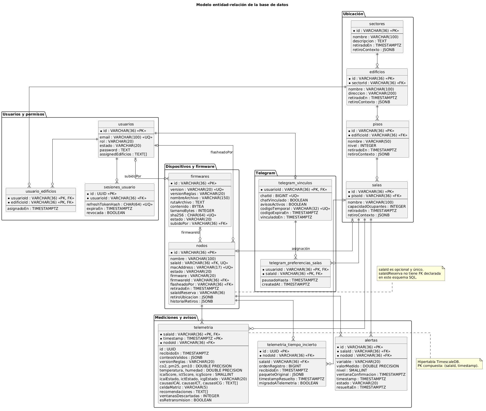

# Base de datos · PostgreSQL 16 + TimescaleDB

[`schema_timescaledb.sql`](schema_timescaledb.sql) contiene la estructura inicial para una **base nueva**: lugares, usuarios, nodos, firmware, telemetría, alertas y preferencias Telegram, además de vistas y funciones SQL. El [modelo ER en PNG y su fuente PlantUML](diagramas/README.md) se mantiene en esta carpeta. Los cambios históricos de instalaciones previas están en [`k8s/migrations/`](../../k8s/migrations/README.md).

## Crear una instalación nueva

1. Crea una base PostgreSQL 16 vacía con TimescaleDB disponible. La cuenta utilizada para instalar debe poder crear las extensiones `pgcrypto` y `timescaledb`.
2. Desde la raíz del clon, ejecuta `psql -h localhost -U postgres -d postgres -v ON_ERROR_STOP=1 -f 'contenido/base de datos/schema_timescaledb.sql'`. `psql` solicita la contraseña; no la escribas en el comando ni en Git.
3. Verifica extensiones con `psql -h localhost -U postgres -d postgres -Atc "SELECT extname FROM pg_extension WHERE extname IN ('pgcrypto','timescaledb') ORDER BY extname"` y tablas con `psql -h localhost -U postgres -d postgres -Atc "SELECT to_regclass('public.usuarios'),to_regclass('public.telemetria')"`.
4. Crea el primer ADMIN mediante [`scripts/bootstrap_admin.py`](../../scripts/README.md), nunca insertando una contraseña en texto plano.

El esquema ya incorpora varios cambios repetidos en las migraciones antiguas. **No apliques automáticamente todos los SQL de `k8s/migrations` después del esquema inicial.** Tampoco uses este archivo como procedimiento de actualización sobre una base existente: contiene DDL, vistas, triggers y cambios pensados para inicialización; primero compara el estado y prepara una migración concreta.

## Modelo y evolución

Los identificadores de sectores, edificios, pisos, salas y nodos son UUID generados por PostgreSQL como texto; no deben introducirse manualmente ni tienen por qué ser números secuenciales. Los nombres activos tienen restricciones de unicidad según su nivel de jerarquía. Los retiros pueden conservar referencias históricas o eliminar historial si el administrador lo solicita explícitamente. La telemetría registra la ventana, el nodo, la sala, variables, índices y reglas; una tabla separada conserva ventanas con hora incierta.

Para actualizar una instalación existente: identifica versión/objetos actuales, haz un respaldo con `pg_dump -Fc`, revisa el SQL de la migración pendiente, ejecútalo en una copia de prueba, valida vistas y consultas del API y luego repite en producción durante una ventana controlada. Los respaldos contienen datos operativos y **no se publican**. La existencia de `IF NOT EXISTS` en algunas sentencias no garantiza que todo el esquema sea reejecutable sin riesgo. No se ha verificado que esta copia coincida al 100 % con una base de producción actual.

Las figuras son conceptuales: si difieren de una columna o relación vigente, el SQL aplicado en la instancia y las migraciones son la referencia. No se distribuye una exportación de datos reales.
