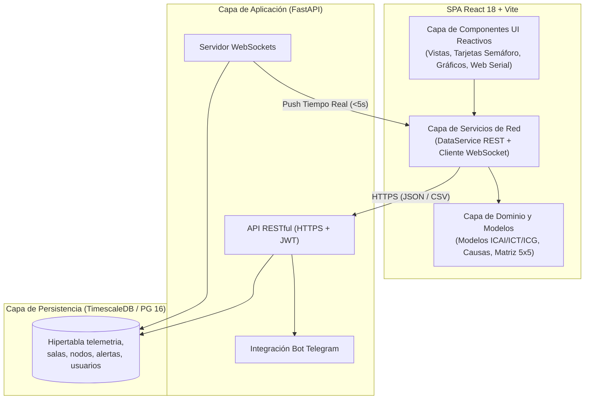
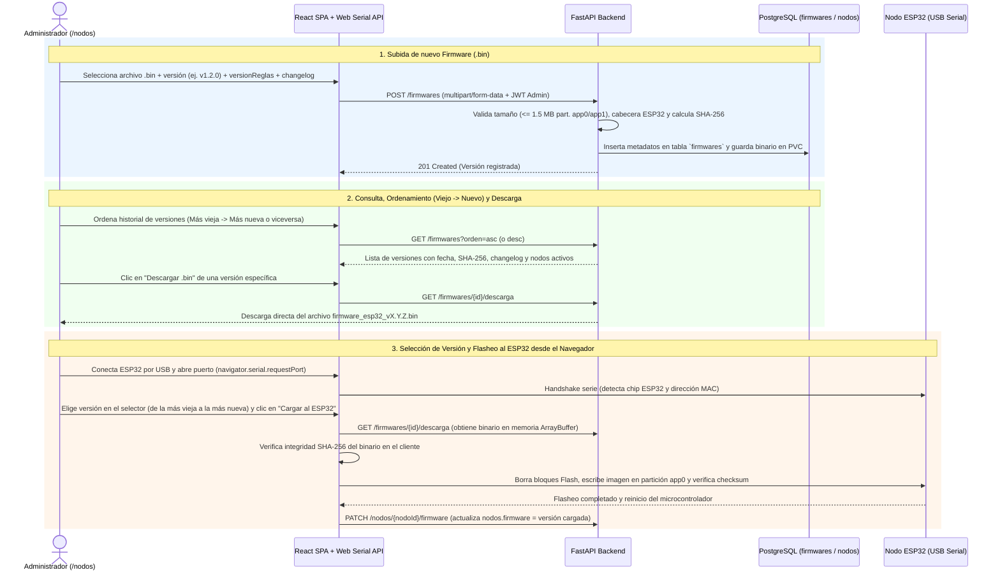

# Especificación de la Página Web: Tecnologías, Módulos, Páginas y Niveles de Acceso (RBAC)

> **Fuente documental:** Extraído íntegramente del informe técnico en LaTeX (`main.tex`) y su contrato complementario de la Etapa 2 (`openapi_etapa2.yaml`).

---

## 1. Tecnologías de la Página Web y Ecosistema Asociado

El sistema de visualización y monitoreo ambiental universitario se implementa como una **Aplicación de Página Única (*Single Page Application* - SPA)** desacoplada, conectada de forma asíncrona con un backend de microservicios y una base de datos de series temporales.

### 1.1. Stack del Frontend (Capa de Presentación Web)

| Tecnología / API | Versión / Estándar | Propósito en la Página Web | Justificación según el `.tex` |
| :--- | :--- | :--- | :--- |
| **React** | `v18` | Biblioteca principal de interfaz de usuario (UI) basada en componentes reactivos y reutilizables. | Ecosistema maduro para dashboards IoT, encapsulamiento modular de los índices ambientales (`ICG`, `ICAI`, `ICT`) por sala y soporte nativo para flujos por WebSockets. |
| **Vite** | — | Herramienta de compilación y empaquetado (*bundler*) del proyecto frontend. | Provee un entorno de desarrollo rápido y empaquetado optimizado para producción de la SPA en JavaScript/TypeScript modular. |
| **React Router** | `v6` | Enrutamiento declarativo en el cliente y protección de rutas autenticadas. | Soporta la navegación jerárquica en cascada (`Sector → Edificio → Piso → Sala`) y redirección automática hacia `/login` ante ausencia de sesión JWT. |
| **Chart.js / ApexCharts** | — | Bibliotecas de visualización de datos y gráficos interactivos de series temporales. | Renderizado fluido de ventanas históricas de 5 minutos, bandas operacionales por contaminante y comparativas de medias móviles de 24 horas. |
| **WebSockets API** | Nativo (WSS) | Canal de comunicación persistente y bidireccional en tiempo real con el backend. | Permite actualizar tarjetas de salas e inyectar alertas operacionales en **menos de 5 segundos** desde la recepción del paquete en el backend (**RNF-09**). |
| **Web Serial API** | Nativo del navegador | Comunicación directa por puerto serie USB entre el navegador web y el microcontrolador ESP32. | Utilizada en la vista `/nodos` para detectar placas ESP32 por USB, flashear el firmware oficial y aprovisionar credenciales Wi-Fi y tokens JWT sin software externo. |

### 1.2. Stack del Backend y API Gateway (Soporte directo a la Web)

| Tecnología | Versión / Estándar | Rol en la Plataforma Web |
| :--- | :--- | :--- |
| **Python + FastAPI** | Python `3.11+` / ASGI | Framework asíncrono (`>15.000 req/s`) que expone la API REST segura, gestiona el servidor WebSocket, suscribe la ingesta desde el broker MQTT y opera la integración con el Bot de Telegram. **No recalcula** los índices `ICAI`, `ICT` ni `ICG` (calculados en el borde por el ESP32). |
| **Pydantic** | — | Validación estructural, de tipos, rangos y coherencia temporal de los paquetes JSON de telemetría y de las peticiones/respuestas de la API REST. |
| **OpenAPI / Swagger / ReDoc** | `3.0.3` | Especificación formal y documentación autogenerada de los endpoints REST (`openapi_etapa2.yaml`). |

### 1.3. Base de Datos y Persistencia

| Tecnología | Versión / Componente | Rol en la Plataforma Web |
| :--- | :--- | :--- |
| **PostgreSQL + TimescaleDB** | PostgreSQL `16` | Motor relacional híbrido optimizado para series temporales. Almacena la jerarquía espacial (`sectores`, `edificios`, `pisos`, `salas`), dispositivos (`nodos`), cuentas (`usuarios`), avisos (`alertas`) y lecturas. |
| **Hipertabla `telemetria`** | Particionado cada 7 días | Almacena las ventanas de 5 minutos con hora verificable mediante clave primaria compuesta `(salaId, timestamp)` para evitar duplicados ante retransmisiones. |
| **Tabla `telemetria_tiempo_incierto`** | Almacenamiento separado (`JSONB`) | Retiene ventanas retransmitidas sin sincronización NTP verificable para no contaminar las vistas fechadas ni disparar alertas falsas hasta resolver su marca temporal. |
| **Triggers SQL (`trg_confirmar_aviso_ambiental`)** | Procedimiento nativo | Evalúa en `< 1 segundo` tras cada inserción si existen dos ventanas válidas consecutivas de 5 minutos con `ICG >= 3` y al menos una misma variable causal, registrando el aviso en `alertas`. |

### 1.4. Seguridad, Comunicaciones e Infraestructura de Despliegue

* **Autenticación y Autorización Web:** Tokens **JWT (`Bearer`)** emitidos al iniciar sesión para consumir la API REST y establecer sesiones WebSocket; contraseñas almacenadas con hash criptográfico **bcrypt** en la tabla `usuarios`. *(Nota: los nodos IoT utilizan tokens JWT de dispositivo independientes sobre MQTTS en el puerto `8883` vía **Eclipse Mosquitto v2.x**).*
* **Contenerización:** Imágenes **Docker** ligeras construidas con *multi-stage builds* y almacenadas en el registro institucional.
* **Orquestación en Kubernetes:**
  * `Deployment` para la SPA de React y el backend FastAPI con réplicas adaptativas y política `restartPolicy: Always` (disponibilidad $\ge 95\,\%$, **RNF-07**).
  * `StatefulSet` + `PersistentVolumeClaim` (PVC sobre almacenamiento NVMe/SAN) para TimescaleDB y Mosquitto.
  * `ConfigMap` y `Secret` para inyección desacoplada de variables de entorno, claves JWT y certificados.
* **Enrutamiento y TLS:** **NGINX Ingress Controller** con DNS configurado por el operador y gestión de certificados SSL/TLS (HTTPS) mediante `cert-manager` o una autoridad de confianza elegida por el despliegue.

---

## 2. Arquitectura Modular de la Página Web

La aplicación web se divide tanto a nivel de **arquitectura interna de software (capas del frontend)** como a nivel de **módulos funcionales de negocio**.

### 2.1. Capas Internas del Frontend (Sección 6.6.1 del `.tex`)

1. **Capa de Dominio y Modelos:**
   * Define las estructuras de datos para las 5 variables monitoreadas ($\text{CO}_2$, $\text{PM}_{2.5}$, $\text{PM}_{10}$, Temperatura y Humedad relativa) y los 3 índices ambientales (**ICAI**, **ICT** e **ICG**).
   * Modela los estados de validez (`completo`, `parcial`, `dato_insuficiente`), niveles de severidad ($S \in \{0, 1, 2, 3, 4\}$), categorías (*Óptimo*, *Precaución*, *Deficiente*, *Malo*, *Crítico*), el vector de severidades por dominio $D = (S_{\text{aire}}, S_{\text{termico}})$, la Matriz Diagnóstica $5 \times 5$ (`O`, `A1..A4`, `T1..T4`, `M1..M4`) y los conjuntos causales $C$ (incluyendo empates).
   * **Principio de diseño:** El frontend **no** aplica bandas ni recalcula ecuaciones; presenta de forma íntegra el resultado calculado en el nodo ESP32 junto con la versión de reglas (`versionReglas`).

2. **Capa de Servicios de Red (`DataService` y WebSockets):**
   * **`DataService` (Cliente HTTP/HTTPS):** Gestiona las peticiones hacia la API REST de FastAPI inyectando el token JWT de usuario, manejando filtros temporales, paginación y descarga de blobs `CSV`/`JSON`.
   * **Cliente WebSocket:** Escucha eventos en tiempo real por sala y avisos operacionales. Implementa el control de vigencia temporal: la tarjeta de estado actual de una sala sólo se actualiza si la ventana recibida posee una marca temporal verificable (`timestamp`) **más reciente** que la expuesta en pantalla; los paquetes atrasados retransmitidos desde el buffer *LittleFS* del nodo se insertan en las series históricas sin sobrescribir la lectura actual.
   * **Servicio de Preferencias Telegram:** Comunica la vista `/telegram` con FastAPI (`/telegram/vinculo` y `/telegram/preferencias`); el navegador nunca interactúa directamente con la API de Telegram.

3. **Capa de Componentes UI Reactivos:**
   * **Navegador Espacial en Cascada:** Componentes de exploración jerárquica (`Sector → Edificio → Piso → Sala`).
   * **Tarjetas de Semaforización Ambiental:** Indicadores visuales codificados por color según la categoría del `ICG` o badges de estado (`Parcial` / `Dato insuficiente`).
   * **Paneles Diagnósticos y de Recomendación:** Visualización de la Matriz $5\times 5$, variables causales empatadas y mensajes de recomendación preventiva o de revisión (Tablas 6.7 y 6.8 del `.tex`).
   * **Visualizadores de Series Temporales y Comparativa OMS:** Gráficos interactivos en Chart.js / ApexCharts para ventanas de 5 minutos con bandas operacionales, y componente separado para medias móviles válidas de 24 horas de $\text{PM}_{2.5}$ ($15\,\mu\text{g/m}^3$) y $\text{PM}_{10}$ ($45\,\mu\text{g/m}^3$) según referencia informativa de la OMS.
   * **Controlador Web Serial:** Interfaz de conexión USB para flasheo y configuración local de placas ESP32 desde el navegador.

### 2.2. Módulos Funcionales del Dashboard

1. **Módulo de Seguridad, Autenticación y Perfil:** Inicio de sesión institucional (`/login`), manejo de tokens JWT y autogestión de cuenta (`/perfil`).
2. **Módulo de Monitoreo Espacial en Tiempo Real:** Visualización jerárquica del campus (`/dashboard`, `/sectores/:sectorId`, `/edificios/:edificioId`, `/pisos/:pisoId`, `/salas/:salaId`).
3. **Módulo de Análisis Histórico y Exportación:** Consultas longitudinales por rangos de fecha, estadísticas agregadas y descarga de reportes en `CSV` y `JSON` (`/historico`).
4. **Módulo de Alertas Operacionales:** Bandeja auditable de eventos persistentes confirmados por el trigger SQL y banner de notificaciones en vivo (`/alertas`).
5. **Módulo de Integración con Bot de Telegram:** Vinculación segura de cuenta mediante código temporal y suscripción personalizada a salas autorizadas (`/telegram`).
6. **Módulo de Administración de Nodos y Usuarios (Backoffice):** Aprovisionamiento físico vía *Web Serial API* y asignación de salas (`/nodos`), junto con administración de cuentas y permisos RBAC (`/usuarios`).

---

## 3. Páginas (Vistas y Rutas) de la Aplicación Web

El enrutamiento de la SPA (gestionado con **React Router v6**) sigue una jerarquía espacial en cascada para el monitoreo y rutas dedicadas para análisis, alertas y administración:

$$\text{Sector} \longrightarrow \text{Edificio} \longrightarrow \text{Piso} \longrightarrow \text{Sala} \longrightarrow \text{Telemetría en Tiempo Real}$$

A continuación se detallan las **12 páginas (vistas)** especificadas en la Sección 6.6.3 del `.tex`:

### 3.1. Detalle de las 12 Vistas del Dashboard

| # | Página / Vista | Ruta (React Router) | Módulo | Descripción y Funcionalidades Clave | Endpoints REST / Canales Asociados | Tablas de BD Involucradas |
| :-: | :--- | :--- | :--- | :--- | :--- | :--- |
| **1** | **Inicio de Sesión** | `/login` | Autenticación | Interfaz pública de acceso. Valida credenciales (`email`, `password`) contra la API REST, almacena el token JWT en el cliente y redirige a `/dashboard` según el perfil del usuario. | `POST /auth/login` | `usuarios` |
| **2** | **Vista General** | `/dashboard` | Monitoreo Espacial | Panel principal. Muestra resumen espacializado de todos los sectores permitidos, un **banner superior de alertas activas** y tarjetas resumidas con semaforización del **ICG** (*Óptimo*: 0, *Precaución*: 1, *Deficiente*: 2, *Malo*: 3, *Crítico*: 4, o bien *Parcial* / *Dato insuficiente*). | `GET /salas/{salaId}/estado` `GET /alertas` `WebSocket` | `sectores`, `edificios`, `salas`, `telemetria`, `alertas` |
| **3** | **Vista de Sector** | `/sectores/:sectorId` | Monitoreo Espacial | Presenta el estado ambiental comparativo de todos los edificios pertenecientes a un campus o predio universitario específico (ej. Campus Norte, Campus Alemania). | `GET /salas/{salaId}/estado` `WebSocket` | `sectores`, `edificios`, `salas`, `telemetria` |
| **4** | **Vista de Edificio** | `/edificios/:edificioId` | Monitoreo Espacial | Desglosa los niveles o pisos arquitectónicos de un inmueble específico, destacando visualmente las zonas o plantas con indicadores ambientales degradados. | `GET /salas/{salaId}/estado` `WebSocket` | `edificios`, `pisos`, `salas`, `telemetria` |
| **5** | **Vista de Piso** | `/pisos/:pisoId` | Monitoreo Espacial | Matriz operativa que despliega tarjetas individuales por cada sala del piso. Muestra las medias de 5 minutos de las 5 variables ($\text{CO}_2$, $\text{PM}_{2.5}$, $\text{PM}_{10}$, Temperatura, Humedad) de la ventana con hora verificable más reciente, la hora de dicha ventana y el estado de conexión del nodo (`conectado` / `desconectado`). | `GET /salas/{salaId}/estado` `WebSocket` | `pisos`, `salas`, `nodos`, `telemetria` |
| **6** | **Vista de Sala** | `/salas/:salaId` | Monitoreo Espacial | Panel diagnóstico detallado del recinto: • Índices **ICG**, **ICAI** e **ICT** y su estado de completitud. • Clasificación en la **Matriz $5 \times 5$**, vector de severidades $D$ y conjuntos causales $C$ (mostrando todas las variables en caso de empate). • Recomendación operacional (preventiva o de revisión, y aviso al encargado si hay persistencia). • Medias de la última ventana de 5 min verificable, su hora exacta y gráficos históricos (que sí integran ventanas atrasadas) con bandas operacionales. • **Vista separada informativa:** medias válidas de 24 h de $\text{PM}_{2.5}$ y $\text{PM}_{10}$ comparadas con las referencias OMS ($15$ y $45\,\mu\text{g/m}^3$). | `GET /salas/{salaId}/estado` `GET /salas/{salaId}/telemetria` `WebSocket` | `salas`, `nodos`, `telemetria`, `alertas` |
| **7** | **Análisis Histórico** | `/historico` | Análisis y Exportación | Herramienta de consulta longitudinal. Permite filtrar en cascada por ubicación y seleccionar un rango de fechas (`desde`, `hasta`), renderizando gráficos evolutivos, tablas resumen de **promedios, máximos y mínimos**, y botones de exportación descargable en formatos **CSV** y **JSON**. | `GET /salas/{salaId}/telemetria` `GET /salas/{salaId}/exportacion` | `sectores`, `edificios`, `pisos`, `salas`, `telemetria` |
| **8** | **Registro de Alertas** | `/alertas` | Alertas Operacionales | Historial auditable de avisos operacionales confirmados (persistencia de $\text{ICG} \ge 3$ con la misma variable causal durante 2 ventanas válidas consecutivas de 5 min). Incluye filtros por recinto (`salaId`), variable ambiental y rango temporal (`desde`, `hasta`), mostrando valor medido, nivel (3 o 4), ventana de confirmación y estado (`activa`, `resuelta`). | `GET /alertas` `WebSocket` | `alertas`, `salas`, `nodos` |
| **9** | **Gestión de Nodos** | `/nodos` | Administración IoT | Panel administrativo de hardware y gestor de firmware: • Consultar estado, versión de firmware instalada y última telemetría de cada nodo, y asignarlo a una sala. • **Gestor de versiones de firmware:** subir nuevos binarios (`.bin`), listarlos ordenados **de la versión más vieja a la más nueva** (o viceversa) y **descargar** cualquier versión al PC. • **Flasheo Web Serial API (USB):** detectar placas ESP32 conectadas por USB, **elegir qué versión del historial cargar** (permitiendo *upgrade* o *rollback* a versiones anteriores), flashear el código desde el navegador y configurar SSID Wi-Fi y token JWT. | `GET /nodos/{nodoId}` `PATCH /nodos/{nodoId}/asignacion` `POST /firmwares` `GET /firmwares` `GET /firmwares/{id}/descarga` `Web Serial API (USB)` | `nodos`, `salas`, `firmwares` |
| **10** | **Gestión de Usuarios** | `/usuarios` | Administración RBAC | Panel de control de acceso basado en roles. Permite crear cuentas de usuario, asignar roles (`ADMIN`, `ANALISTA`, `VIEWER`, `GUEST`), activar/desactivar cuentas, gestionar contraseñas y asignar los edificios permitidos (`assignedEdificios`). | Endpoints de gestión de usuarios (API REST) | `usuarios`, `edificios` |
| **11** | **Integración Telegram** | `/telegram` | Notificaciones y Bot | Permite vincular la cuenta web autenticada con un chat de Telegram mediante un código temporal confirmado desde el bot (sin usar el número telefónico como prueba de identidad). Permite activar/desactivar avisos y seleccionar salas dentro del ámbito de acceso del usuario para recibir alertas, consultar estados o solicitar exportaciones CSV/JSON desde el bot. | `POST /telegram/vinculo` `GET /telegram/preferencias` `PUT /telegram/preferencias` | `usuarios`, relación de preferencias de Telegram, `salas` |
| **12** | **Perfil** | `/perfil` | Autenticación y Cuenta | Gestión personal de las credenciales de acceso (cambio de contraseña) y visualización/edición de los datos básicos de la cuenta del usuario autenticado. | Endpoints de perfil de usuario (API REST) | `usuarios` |

---

### 3.2. Detalle Especializado de la Vista `/nodos`: Gestor de Versiones, Subida, Descarga y Carga de Firmware al ESP32

> **Nota de trazabilidad:** El informe base (`main.tex`, Sección 6.6.3 y Tabla 7.1) define que `/nodos` utiliza la **Web Serial API** para detectar el ESP32 por USB, flashear el firmware y configurar credenciales Wi-Fi/JWT, además de almacenar `nodos.firmware` y `telemetria.versionReglas`. A continuación se detalla el **Gestor de Versiones de Firmware** integrado en esta vista para administrar el ciclo completo de binarios desde el navegador.

#### A. Subir un Nuevo Firmware desde el Navegador
Dentro de `/nodos`, el administrador dispone del panel **"Subir Nueva Versión de Firmware"**:
* **Archivo binario (`.bin`):** Carga mediante selector de archivos o *drag-and-drop*. El sistema valida que sea un binario compilado para arquitectura ESP32 (byte mágico `0xE9`) y que su tamaño **no supere `1.5 MB` (`1.572.864 bytes`)**, respetando el límite físico de las particiones `app0` / `app1` definido en la Sección 6.7.3 del `.tex`.
* **Etiqueta de versión (`version`):** Versión semántica única (ej. `v1.0.0`, `v1.1.0`, `v1.2.0`), que se correlaciona con el campo `nodos.firmware`.
* **Versión de reglas (`versionReglas`):** Identificador de la versión del algoritmo y bandas de los índices `ICAI`, `ICT` e `ICG` embebidos en ese firmware (ej. `reglas-2026.1`), garantizando trazabilidad directa con la columna `versionReglas` de la hipertabla `telemetria` (**RF-12**).
* **Estado de la versión:** Permite clasificarla como **`oficial` (estable/recomendada)**, **`prueba` (beta)** u **`obsoleta` (deprecada)**. Al marcar una versión como `oficial`, queda preseleccionada por defecto para futuros flasheos.
* **Notas de versión (*Changelog*):** Descripción técnica de los cambios introducidos (ajustes en drivers `SCD4xDriver` / `PMS5003Driver`, mejoras en la FSM de reconexión, cambios de umbrales, etc.).
* **Verificación de integridad (`SHA-256`):** Al subir el archivo, se calcula su huella `SHA-256` y se almacena en la base de datos para impedir que un binario corrupto o incompleto sea descargado o flasheado en un nodo.

#### B. Gestor e Historial de Versiones (Ordenamiento de la Más Vieja a la Más Nueva)
El catálogo de versiones ofrece una tabla auditable y un selector interactivo con las siguientes capacidades:
* **Ordenamiento cronológico y por versión:**
  * **De la más vieja a la más nueva (`ASC`):** Permite visualizar la evolución histórica desde el primer firmware base (`v1.0.0`) hasta la compilación más reciente.
  * **De la más nueva a la más vieja (`DESC`):** Muestra en primer lugar las últimas compilaciones subidas.
* **Información expuesta por cada versión:**
  * Número de `version` y badge de estado (`Oficial`, `Prueba`, `Obsoleta`).
  * `versionReglas` asociada al cálculo de índices.
  * Fecha y hora exacta de subida (`createdAt`) y administrador que la publicó.
  * Tamaño del archivo (en KB / MB) y hash `SHA-256` abreviado (con botón para copiar el hash completo).
  * **Recuento de adopción en vivo:** Cantidad de nodos del campus que tienen instalada actualmente esa versión (calculado cruzando con `nodos.firmware`).

#### C. Descargar Cualquier Versión de Firmware al Computador
* Cada registro en el gestor de versiones cuenta con la acción **"Descargar `.bin`"**.
* Al seleccionarla, el navegador solicita `GET /firmwares/{firmwareId}/descarga` con el token JWT del administrador y descarga el archivo con nombre estandarizado (por ejemplo, `firmware_esp32_v1.1.0.bin`).
* Esto permite conservar copias locales de respaldo, auditar compilaciones históricas o realizar flasheos en laboratorio sin conexión a internet si fuese necesario.

#### D. Elegir Versión y Cargar el Código al ESP32 desde el Navegador (Web Serial API)
En la sección **"Flasheo y Aprovisionamiento USB (Web Serial)"** de la vista `/nodos`:
1. **Conexión y detección por USB:** El administrador conecta la placa ESP32 de 38 pines al puerto USB del computador y pulsa **"Conectar ESP32 por USB"**, invocando `navigator.serial.requestPort()`. La página abre la conexión serie (115200 / 460800 baudios), detecta el chip ESP32, lee su dirección MAC e identifica a qué `nodoId` corresponde (mostrando qué versión de `firmware` tiene registrada actualmente).
2. **Selector de versión a cargar:**
   * Se despliega una lista con todas las versiones almacenadas en el servidor, permitiendo ordenarlas **de la más vieja a la más nueva** o viceversa.
   * **Actualización (*Upgrade*):** El administrador puede seleccionar la última versión `oficial` o de `prueba` para actualizar el nodo.
   * **Reversión (*Rollback / Downgrade*):** Si una versión nueva presenta anomalías en terreno, el administrador puede elegir cualquier versión anterior más vieja del listado y volver a cargarla en el ESP32 en segundos.
   * **Opción de binario local:** Adicionalmente, permite cargar un archivo `.bin` directamente desde el computador (con opción de subirlo simultáneamente al repositorio de versiones).
3. **Proceso de carga en el ESP32:**
   * Al pulsar **"Flashear Firmware Seleccionado"**, la SPA descarga en memoria (`ArrayBuffer`) el `.bin` desde FastAPI, comprueba que su hash `SHA-256` coincida exactamente con el registrado en la base de datos y transmite los bloques por **Web Serial** hacia la partición de aplicación del ESP32.
   * La interfaz muestra una **barra de progreso en tiempo real** (porcentaje escrito, velocidad en KB/s y etapa: *Conectando → Borrando Flash → Escribiendo bloques → Verificando MD5/SHA256 → Reiniciando*) junto con un **monitor serie integrado** para observar los logs de arranque (`INIT_SYS`).
4. **Actualización automática de inventario y configuración:**
   * Una vez verificado el flasheo, la web invoca `PATCH /nodos/{nodoId}/firmware` para actualizar automáticamente el campo `nodos.firmware` en PostgreSQL con la versión que se acaba de instalar.
   * Desde la misma conexión USB Web Serial (sin necesidad de abrir el portal cautivo Wi-Fi), el administrador puede inyectar en la partición `nvs` del ESP32 el `wifiSsid`, la contraseña WPA2, el `nodoId`/`salaId` y el `jwtToken` único del dispositivo.

#### E. Tabla de Base de Datos para el Gestor de Firmware (Ampliación Relacional: `firmwares`)

Para persistir el catálogo de versiones y vincularlo con `nodos` y `usuarios`, el esquema incorpora la tabla `firmwares`:

| Columna | Tipo de Dato | Restricciones | Descripción |
| :--- | :--- | :--- | :--- |
| `id` | `VARCHAR(36)` / `UUID` | `PRIMARY KEY` | Identificador único del registro de firmware. |
| `version` | `VARCHAR(20)` | `UNIQUE, NOT NULL` | Etiqueta de versión (ej. `v1.0.0`, `v1.1.0`), vinculada lógicamente con `nodos.firmware`. |
| `versionReglas` | `VARCHAR(20)` | `NOT NULL` | Versión de las reglas de cálculo de `ICAI`, `ICT` e `ICG` contenidas en este binario. |
| `nombreArchivo` | `VARCHAR(150)` | `NOT NULL` | Nombre normalizado del archivo descargable (ej. `firmware_esp32_v1.1.0.bin`). |
| `rutaArchivo` | `TEXT` | `NOT NULL` | Ruta interna en el volumen persistente (PVC en Kubernetes) donde se almacena el binario `.bin`. |
| `tamanoBytes` | `INTEGER` | `NOT NULL, <= 1572864` | Tamaño exacto en bytes (máximo 1.5 MB acorde a la partición `app0`/`app1` del ESP32). |
| `sha256` | `CHAR(64)` | `UNIQUE, NOT NULL` | Hash criptográfico `SHA-256` del archivo `.bin` para verificación de integridad en descarga y flasheo. |
| `estado` | `VARCHAR(20)` | `NOT NULL` | Estado de la versión: `oficial`, `prueba` o `obsoleta`. |
| `changelog` | `TEXT` | `NULLABLE` | Notas técnicas y descripción de cambios de la versión. |
| `subidoPor` | `VARCHAR(36)` | `FOREIGN KEY → usuarios.id` | Administrador que subió la compilación. |
| `createdAt` | `TIMESTAMPTZ` | `NOT NULL, DEFAULT NOW()` | Fecha y hora de publicación (clave para ordenar de la más vieja a la más nueva o viceversa). |

---

## 4. Niveles de Acceso y Control Basado en Roles (RBAC)

Para garantizar la confidencialidad y el aislamiento de la telemetría del campus (**RNF-05**), el sistema aplica un esquema de **Control de Acceso Basado en Roles (RBAC)** tanto en el enrutamiento del frontend como en la validación de cada petición en el backend FastAPI.

### 4.1. Tipos de Usuarios (Roles Definidos en el Sistema y Actores Reales)

De acuerdo con el diccionario de datos de la tabla `usuarios` (Sección 6.4.2, línea 1337 del `.tex`) y la matriz RBAC del frontend (Sección 6.6.4, línea 1745), existen **4 tipos de usuarios (roles)** a nivel de sistema, los cuales se corresponden directamente con los actores de la comunidad universitaria definidos en las Historias de Usuario (Sección 4.2, líneas 612–615):

| Rol en Base de Datos (`usuarios.rol`) | Nombre del Perfil | Actor Real en la Universidad (Historias de Usuario) | Alcance y Permisos Principales |
| :--- | :--- | :--- | :--- |
| **`ADMIN`** | **Administrador del Sistema** | Personal técnico de infraestructura / Administrador de plataforma | **Control total del sistema.** Visibilidad global de todos los sectores, edificios, pisos y salas del campus. Acceso completo a análisis histórico (`/historico`), exportación (`CSV`/`JSON`) y registro de alertas (`/alertas`). **Único rol** con acceso a **Gestión de Nodos (`/nodos`)** (subir/descargar firmwares `.bin`, ordenar versiones de la más vieja a la más nueva, flashear ESP32 por USB Web Serial y reasignar salas) y **Gestión de Usuarios (`/usuarios`)**. En `/telegram`, gestiona preferencias propias y configuración global. |
| **`ANALISTA`** | **Analista Ambiental** | Investigadores / Académicos de estudio longitudinal | **Perfil analítico y de auditoría.** Monitoreo en tiempo real de los recintos asignados a su cuenta, acceso completo a **Análisis Histórico (`/historico`)**, **descarga de reportes en `CSV` y `JSON`** (tanto desde la web como solicitándolos al Bot de Telegram) y auditoría del **Registro de Alertas (`/alertas`)**. Tiene **acceso denegado** a `/nodos` y `/usuarios`. |
| **`VIEWER`** | **Visualizador Operativo** | Encargados de recinto / Docentes / Comunidad autorizada | **Perfil de consulta en tiempo real.** Acceso de sólo lectura en vivo a los sectores, edificios, pisos y salas explícitamente autorizados en su arreglo `assignedEdificios`. Puede vincular su cuenta en `/telegram` para consultar el estado actual de sus salas autorizadas y recibir avisos operacionales confirmados. **Acceso denegado** a `/historico`, descarga `CSV`/`JSON`, `/alertas`, `/nodos` y `/usuarios`. |
| **`GUEST`** | **Invitado** | Visitantes / Cuentas temporales de observación | **Perfil temporal restringido.** Contemplado en el esquema relacional de la tabla `usuarios` (`ADMIN`, `ANALISTA`, `VIEWER`, `GUEST`) para cuentas de acceso mínimo o temporal de sólo lectura en recintos puntuales, sin privilegios de análisis histórico, exportación, alertas ni administración. *(Adicionalmente, estudiantes y profesores dentro del aula pueden visualizar las lecturas e índices directamente en la pantalla física TFT del nodo sin requerir cuenta web, según **HU-02**).* |

---

### 4.2. Matriz de Acceso por Página / Ruta del Dashboard (Tabla 6.10 del `.tex`)

| Vista / Ruta | Nombre de la Página | Rol: `ADMIN` | Rol: `ANALISTA` | Rol: `VIEWER` | Rol: `GUEST` *(BD)* |
| :--- | :--- | :---: | :---: | :---: | :---: |
| `/login` | Inicio de Sesión | Permitido | Permitido | Permitido | Permitido |
| `/dashboard` | Vista General | Acceso Total | Según Permisos | Según Permisos (`assignedEdificios`) | Según Permisos (Restringido) |
| `/sectores/:id` | Vista de Sector | Acceso Total | Según Permisos | Según Permisos (`assignedEdificios`) | Según Permisos (Restringido) |
| `/edificios/:id` | Vista de Edificio | Acceso Total | Según Permisos | Según Permisos (`assignedEdificios`) | Según Permisos (Restringido) |
| `/pisos/:id` | Vista de Piso | Acceso Total | Según Permisos | Según Permisos (`assignedEdificios`) | Según Permisos (Restringido) |
| `/salas/:id` | Vista de Sala | Acceso Total | Según Permisos | Según Permisos (`assignedEdificios`) | Según Permisos (Sólo estado actual) |
| `/historico` | Análisis Histórico y Exportación | Acceso Total | Según Permisos | **Denegado** | **Denegado** |
| `/alertas` | Registro de Alertas | Acceso Total | Según Permisos | **Denegado** | **Denegado** |
| `/nodos` | Gestión de Nodos (Firmware / Web Serial / Salas) | **Exclusivo Admin** | **Denegado** | **Denegado** | **Denegado** |
| `/usuarios` | Gestión de Usuarios (RBAC) | **Exclusivo Admin** | **Denegado** | **Denegado** | **Denegado** |
| `/telegram` | Integración Telegram | Preferencias propias y gestión global | Preferencias propias y exportación (CSV/JSON) | Preferencias propias; sólo estado y avisos autorizados | Sin exportación ni gestión |
| `/perfil` | Perfil de Usuario | Permitido | Permitido | Permitido | Permitido |

---

### 4.3. Reglas Detalladas por Página: ¿Qué puede hacer cada usuario en cada vista?

A continuación se especifican las reglas operacionales exactas y las acciones permitidas o bloqueadas para cada rol dentro de cada una de las **12 páginas**:

#### 1. Inicio de Sesión (`/login`)
* **Usuarios no autenticados / Cualquier rol (`ADMIN`, `ANALISTA`, `VIEWER`, `GUEST`):**
  * **Pueden:** Ingresar su `email` y `password`, enviar el formulario (`POST /auth/login`) y, si la cuenta está en estado `activo`, recibir su token JWT y ser redirigidos a `/dashboard`.
  * **No pueden:** Registrarse por cuenta propia (no existe registro público; las cuentas las crea un `ADMIN` en `/usuarios`) ni elegir su rol desde el login. Si la cuenta está en estado `inactivo`, el ingreso es rechazado (`HTTP 401`).

#### 2. Vista General (`/dashboard`)
* **`ADMIN`:**
  * **Puede:** Ver el resumen de **todos los sectores y edificios de la universidad**, ver el banner superior con todas las alertas operacionales activas del campus y hacer clic para navegar hacia cualquier sector.
* **`ANALISTA`:**
  * **Puede:** Ver el resumen de los sectores/edificios dentro de su ámbito de permisos, visualizar las tarjetas semáforo del `ICG` (*Óptimo*, *Precaución*, *Deficiente*, *Malo*, *Crítico*, *Parcial* o *Dato insuficiente*) y ver el banner de alertas activas de sus recintos autorizados.
* **`VIEWER` (y `GUEST` con edificios asignados):**
  * **Puede:** Ver únicamente las tarjetas resumidas de los sectores que contienen los edificios listados en su campo `assignedEdificios`, con su estado `ICG` actual en tiempo real (vía WebSocket).
  * **No puede:** Ver sectores/edificios no asignados ni navegar al detalle del registro histórico de alertas (`/alertas`).

#### 3. Vista de Sector (`/sectores/:sectorId`)
* **`ADMIN`:**
  * **Puede:** Consultar cualquier sector del campus y comparar el estado ambiental en tiempo real de todos sus edificios.
* **`ANALISTA` y `VIEWER`:**
  * **Pueden:** Acceder al sector **sólo si tienen al menos un edificio autorizado** dentro de ese sector; ven únicamente los edificios permitidos en su perfil (`assignedEdificios`).
  * **No pueden:** Consultar un `:sectorId` ajeno a sus permisos (el backend devuelve `HTTP 403 SinPermiso` y el router bloquea la vista).

#### 4. Vista de Edificio (`/edificios/:edificioId`)
* **`ADMIN`:**
  * **Puede:** Entrar a cualquier edificio, ver el desglose de todos sus pisos y detectar zonas con indicadores degradados.
* **`ANALISTA` y `VIEWER`:**
  * **Pueden:** Ver el desglose de pisos y el estado agregado en tiempo real **únicamente si `:edificioId` pertenece a su lista `assignedEdificios`**.
  * **No pueden:** Acceder por URL directa a edificios no asignados (`HTTP 403`).

#### 5. Vista de Piso (`/pisos/:pisoId`)
* **`ADMIN`:**
  * **Puede:** Ver la matriz completa de tarjetas de todas las salas del piso, con sus 5 medias de 5 minutos ($\text{CO}_2$, $\text{PM}_{2.5}$, $\text{PM}_{10}$, Temperatura, Humedad), la hora de la ventana verificable más reciente y el estado de conexión de cada nodo (`conectado` / `desconectado`).
* **`ANALISTA` y `VIEWER`:**
  * **Pueden:** Ver la misma matriz operativa de salas en tiempo real **siempre que el piso pertenezca a un edificio autorizado** para su cuenta.
  * **No pueden:** Modificar la asignación de nodos ni ver credenciales/tokens de los dispositivos.

#### 6. Vista de Sala (`/salas/:salaId`)
* **`ADMIN` y `ANALISTA` (en salas autorizadas):**
  * **Pueden:**
    1. Ver el estado actual en tiempo real (`GET /salas/{salaId}/estado` + WebSocket): `ICG`, `ICAI`, `ICT`, la clasificación de la Matriz $5\times 5$, el vector $D$, todas las variables causales $C$ (incluidos empates), la recomendación operacional y las medias de los 5 sensores.
    2. Consultar y visualizar los **gráficos históricos interactivos** de la sala (`GET /salas/{salaId}/telemetria`) con sus bandas operacionales, incluyendo ventanas recibidas con retraso ordenadas por hora de medición.
    3. Ver la vista separada informativa de promedios móviles de 24 horas de $\text{PM}_{2.5}$ y $\text{PM}_{10}$ comparados con la referencia OMS ($15$ y $45\,\mu\text{g/m}^3$).
* **`VIEWER` (en salas de sus `assignedEdificios`):**
  * **Puede:** Ver en tiempo real la tarjeta diagnóstica actual de la sala (`GET /salas/{salaId}/estado` + WebSocket): semáforo `ICG`, `ICAI`, `ICT`, Matriz $5\times 5$, causas, recomendación operacional (incluyendo el aviso *"Avise al encargado"* cuando se confirma persistencia) y las 5 mediciones de la ventana actual.
  * **Restricción de historial según contrato OpenAPI:** En `openapi_etapa2.yaml`, el endpoint `GET /salas/{salaId}/telemetria` tiene `x-roles-permitidos: [ADMIN, ANALISTA]`, por lo que el `VIEWER` sólo tiene garantizada la consulta del estado actual en vivo, no la consulta libre de rangos históricos ni la exportación.

#### 7. Análisis Histórico (`/historico`)
* **`ADMIN`:**
  * **Puede:** Seleccionar en cascada cualquier `Sector → Edificio → Piso → Sala` del campus, definir cualquier rango de fechas (`desde`, `hasta`), visualizar gráficos evolutivos y tablas de **promedio, máximo y mínimo**, y **descargar reportes en `CSV` y `JSON`** (`GET /salas/{salaId}/exportacion`).
* **`ANALISTA`:**
  * **Puede:** Realizar exactamente las mismas consultas históricas, ver tablas estadísticas y **descargar archivos `CSV` y `JSON`**, pero **restringido únicamente a las salas/edificios autorizados** en su cuenta.
* **`VIEWER` y `GUEST`:**
  * **Acceso Denegado:** No pueden entrar a `/historico` (la ruta redirige en React y los endpoints `/salas/{salaId}/telemetria` y `/salas/{salaId}/exportacion` rechazan sus peticiones con `HTTP 403`).

#### 8. Registro de Alertas (`/alertas`)
* **`ADMIN`:**
  * **Puede:** Auditar el historial completo de avisos operacionales confirmados de todo el campus (`GET /alertas`), filtrar por cualquier sala, variable causal ($\text{CO}_2$, $\text{PM}_{2.5}$, $\text{PM}_{10}$, Temperatura, Humedad) y rango de fechas, y recibir nuevas alertas confirmadas en vivo por WebSocket.
* **`ANALISTA`:**
  * **Puede:** Consultar y filtrar el historial auditable de alertas confirmadas y recibir actualizaciones en tiempo real, pero **acotado a las salas que tiene permiso para ver**.
* **`VIEWER` y `GUEST`:**
  * **Acceso Denegado:** No tienen acceso a la vista de auditoría histórica `/alertas` (`HTTP 403` en `GET /alertas`). *(Nota: el `VIEWER` sí ve las recomendaciones y avisos vigentes en tiempo real dentro de sus salas autorizadas o en su Telegram si lo vinculó).*

#### 9. Gestión de Nodos (`/nodos`)
* **`ADMIN` (Exclusivo):**
  * **Puede:**
    1. Consultar el estado técnico, firmware instalado, última telemetría y sala asignada de todos los nodos (`GET /nodos/{nodoId}`).
    2. Asignar o cambiar administrativamente qué nodo está en qué sala (`PATCH /nodos/{nodoId}/asignacion`).
    3. **Subir nuevas versiones de firmware (`.bin`)** al servidor (`POST /firmwares`) indicando versión, `versionReglas`, estado (`oficial`, `prueba`, `obsoleta`) y *changelog*.
    4. **Visualizar y ordenar el historial de versiones** de la más vieja a la más nueva (`ASC`) o de la más nueva a la más vieja (`DESC`) (`GET /firmwares`).
    5. **Descargar cualquier versión de firmware (`.bin`)** a su computador (`GET /firmwares/{id}/descarga`).
    6. Conectar un ESP32 por USB mediante **Web Serial API**, **elegir qué versión del selector cargar** (actualización o *rollback* a una versión más vieja), flashear la memoria Flash y configurar el `SSID` Wi-Fi y el `jwtToken` del nodo.
* **`ANALISTA`, `VIEWER` y `GUEST`:**
  * **Acceso Totalmente Denegado:** Ruta oculta/bloqueada en el frontend y rechazada con `HTTP 403` en todos los endpoints `/nodos/*` y `/firmwares/*`.

#### 10. Gestión de Usuarios (`/usuarios`)
* **`ADMIN` (Exclusivo):**
  * **Puede:** Listar todas las cuentas, crear nuevos usuarios, asignar o cambiar su rol (`ADMIN`, `ANALISTA`, `VIEWER`, `GUEST`), activar o desactivar cuentas (`estado: activo | inactivo`), restablecer contraseñas (hash `bcrypt`) y definir qué edificios puede ver cada usuario (`assignedEdificios`).
* **`ANALISTA`, `VIEWER` y `GUEST`:**
  * **Acceso Totalmente Denegado:** No pueden ver ni modificar cuentas de otros usuarios (`HTTP 403`).

#### 11. Integración Telegram (`/telegram`)
* **`ADMIN`:**
  * **Puede:** Vincular su propia cuenta con un chat de Telegram mediante código temporal (`POST /telegram/vinculo`), elegir cualquier sala del campus para recibir avisos (`PUT /telegram/preferencias`), solicitar desde el bot tanto estados actuales como **archivos `CSV`/`JSON` de historial**, y administrar la configuración global de la integración.
* **`ANALISTA`:**
  * **Puede:** Vincular su cuenta personal con su chat de Telegram, activar/desactivar notificaciones y seleccionar salas **dentro de sus edificios autorizados**. Desde el bot de Telegram puede consultar el estado de sus salas, recibir avisos confirmados y **solicitar la descarga de archivos `CSV` o `JSON` históricos** de dichas salas.
* **`VIEWER`:**
  * **Puede:** Vincular su cuenta personal con su chat de Telegram y seleccionar únicamente salas pertenecientes a sus `assignedEdificios` para **consultar el estado actual** o **recibir avisos operacionales confirmados** en su celular.
  * **No puede:** Solicitar archivos de exportación histórica (`CSV`/`JSON`) al bot ni suscribirse a salas fuera de sus permisos (el backend valida el rol y la visibilidad en cada comando enviado al bot).

#### 12. Perfil (`/perfil`)
* **Todos los usuarios autenticados (`ADMIN`, `ANALISTA`, `VIEWER`, `GUEST`):**
  * **Pueden:** Ver sus propios datos de cuenta (`nombre`, `email`, `telefono`, `rol` actual y lista de edificios asignados) y actualizar sus credenciales personales (como cambiar su propia contraseña o teléfono de contacto).
  * **No pueden:** Autoasignarse otro rol (ej. pasar de `VIEWER` a `ADMIN`) ni agregarse edificios adicionales por su cuenta; esos campos son de sólo lectura en `/perfil` y sólo pueden ser modificados por un `ADMIN` en `/usuarios`.

---

### 4.4. Niveles de Acceso en la API REST (`openapi_etapa2.yaml` + Ampliación Gestor de Firmware)

Cada ruta del frontend está respaldada por políticas de autorización a nivel de endpoint en FastAPI mediante validación del token JWT (`bearerAuth`):

| Método | Ruta API REST | Propósito | Roles Permitidos (`x-roles-permitidos`) |
| :---: | :--- | :--- | :--- |
| `POST` | `/auth/login` | Autenticar credenciales y obtener token JWT. | Público (usuarios con cuenta `activo`) |
| `GET` | `/salas/{salaId}/estado` | Obtener la última ventana de 5 min con hora verificable. | `ADMIN`, `ANALISTA`, `VIEWER` *(según visibilidad de sala)* |
| `GET` | `/salas/{salaId}/telemetria` | Consultar historial fechado por rango (`desde`, `hasta`). | `ADMIN`, `ANALISTA` *(Denegado a `VIEWER`)* |
| `GET` | `/salas/{salaId}/exportacion` | Descargar historial autorizado en formato `csv` o `json`. | `ADMIN`, `ANALISTA` *(Denegado a `VIEWER`)* |
| `GET` | `/alertas` | Consultar avisos operacionales confirmados por el trigger SQL. | `ADMIN`, `ANALISTA` *(Denegado a `VIEWER`)* |
| `GET` | `/nodos/{nodoId}` | Consultar estado de conexión, firmware actual y sala asignada a un nodo. | Exclusivo `ADMIN` |
| `PATCH` | `/nodos/{nodoId}/asignacion` | Asignar o reasignar administrativamente un nodo a una sala. | Exclusivo `ADMIN` |
| `PATCH` | `/nodos/{nodoId}/firmware` | *(Ampliación)* Registrar la versión de firmware instalada en el nodo tras flasheo Web Serial. | Exclusivo `ADMIN` |
| `POST` | `/firmwares` | *(Ampliación)* Subir un nuevo archivo binario (`.bin`) con su versión, `versionReglas` y changelog. | Exclusivo `ADMIN` |
| `GET` | `/firmwares` | *(Ampliación)* Listar versiones de firmware ordenadas de la más vieja a la más nueva (`orden=asc`) o viceversa (`orden=desc`). | Exclusivo `ADMIN` |
| `GET` | `/firmwares/{id}/descarga` | *(Ampliación)* Descargar el archivo binario `.bin` al computador o cargarlo en memoria para flasheo Web Serial. | Exclusivo `ADMIN` |
| `PATCH` | `/firmwares/{id}` | *(Ampliación)* Cambiar el estado de una versión (`oficial`, `prueba`, `obsoleta`). | Exclusivo `ADMIN` |
| `POST` | `/telegram/vinculo` | Generar código temporal para vincular la cuenta con Telegram. | Usuario autenticado (`ADMIN`, `ANALISTA`, `VIEWER`) |
| `GET / PUT` | `/telegram/preferencias` | Consultar o guardar salas seleccionadas y activación de avisos. | Usuario autenticado *(validado contra permisos vigentes)* |

### 4.5. Reglas de Seguridad y Consistencia de Permisos

* **Verificación dinámica de permisos:** Tanto en la web como en el Bot de Telegram, el backend comprueba el rol vigente, el estado de la cuenta (`activo`) y la visibilidad sobre la sala **en cada solicitud y antes de cada envío**. Si a un usuario se le revoca el acceso a un edificio o sala, una preferencia guardada previamente en `/telegram` queda bloqueada de inmediato y no permite recibir nuevas alertas ni exportaciones.
* **Identidad verificada en Telegram:** El campo `telefono` de la tabla `usuarios` es únicamente informativo; la autorización del Bot se vincula estrictamente al identificador del chat (`chat_id`) confirmado mediante el flujo iniciado en `POST /telegram/vinculo`.
* **Protección ante falta de autenticación:** Cualquier petición sin un token JWT válido recibe `HTTP 401 (NoAutenticado)` y cualquier intento de acceder a una ruta o sala fuera del rol/visibilidad del usuario recibe `HTTP 403 (SinPermiso)`.
