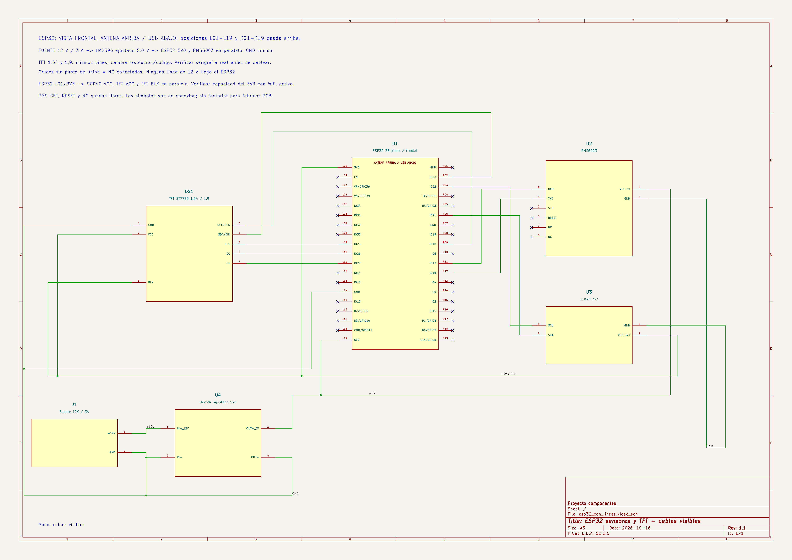
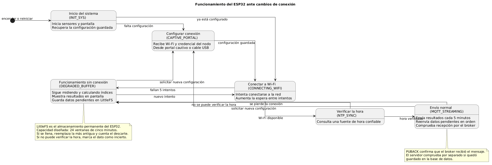

# Firmware del nodo ESP32

`esp32_nodo_aira.ino` lee SCD40 y PMS5003, calcula ICAI/ICT/ICG por ventanas de cinco minutos, muestra lecturas y niveles en ST7789 y publica MQTT QoS 1 sobre WSS. Cuando no puede entregar una ventana, la conserva en LittleFS y reintenta. La versión declarada en `config.h` es `v1.0.8` con reglas `reglas-2026.1`; compruébala antes de compilar o registrar un binario. Desde v1.0.8 cada paquete incluye los datos de auditoría descritos en [CAMBIOS_AUDITORIA_ESP32_V108.md](../CAMBIOS_AUDITORIA_ESP32_V108.md).

## 1. Revisar placa y cableado

Abre el [esquema KiCad editable y su exportación PNG](hardware/README.md) y compara **la serigrafía de tu placa física** con sus posiciones de pines. El proyecto usa ESP32 de 38 pines, SCD40 por I²C, PMS5003 por UART2 y ST7789 por SPI. El esquema documenta cableado, no una PCB fabricable. Con alimentación externa, ajusta y mide el LM2596 a 5,0 V antes de conectar la placa; nunca lleves 12 V al ESP32. Comprueba GND común, polaridad, corriente disponible en 3V3 y voltajes bajo carga Wi‑Fi. Un ERC correcto no sustituye esas mediciones.

## 2. Preparar compilación

Instala Arduino IDE o Arduino CLI, core Arduino-ESP32 **3.3.12**, y bibliotecas **Adafruit GFX Library** y **Adafruit ST7735 and ST7789 Library**. Usa el perfil de placa ESP32 correspondiente al módulo real; el código se trabajó con un ESP32 clásico. `config.h` define pines, umbrales, periodos y `DISPLAY_VARIANT`: `154` para 240×240 o `190` para 170×320. Mantén el modo de prueba rápida desactivado para ventanas oficiales de 10 s por muestra y 5 min por ventana.

Copia `secrets.h.example` a `secrets.h`. Este último se ignora en Git. Deja los campos vacíos si usarás el aprovisionamiento USB desde la web; nunca incorpores SSID, contraseña, token MQTT, IDs reales o certificados privados en un commit. La configuración recibida por USB se guarda en NVS. El flujo actual no cambia de Wi‑Fi inalámbricamente.

## 3. Compilar y cargar

Abre `esp32_nodo_aira.ino` en Arduino IDE, elige placa y puerto, y compila. También puedes usar Arduino CLI con el FQBN de tu placa, por ejemplo `arduino-cli compile --fqbn esp32:esp32:esp32 esp32_nodo_aira`; revisa que las bibliotecas estén instaladas y que `secrets.h` exista. Para cargar manualmente usa Arduino IDE o `arduino-cli upload --fqbn esp32:esp32:esp32 -p <PUERTO> esp32_nodo_aira`. Los binarios generados se excluyen de Git. Para cargar desde la aplicación web, registra primero una versión de firmware en la plataforma y sigue [web/README.md](../web/README.md).

## 4. Aprovisionar y verificar

En la web crea la jerarquía de sector, edificio, piso y sala; crea el nodo, asigna la sala y selecciona Wi‑Fi al cargarlo por USB. El navegador escribe la configuración en NVS. En el monitor serie comprueba arranque, sensores, Wi‑Fi, reloj NTP, MQTT y cada publicación de ventana. `PUBACK` confirma la recepción MQTT; comprueba además la ingesta del API y la nueva lectura en la sala. Una ventana parcial puede mostrar PM₂.₅/PM₁₀ nulos si el PMS5003 no está conectado.

## Diagnóstico

Si Web Serial no detecta la placa, usa un cable de datos, confirma puerto y mantén BOOT durante `Connecting...` hasta que el registro indique detección. Si aparece error TLS/MQTT, revisa hora NTP, certificado, URL WSS, credencial de nodo y broker. Si hay reinicios, mide la fuente y 3V3 con Wi‑Fi y sensores activos. Si la pantalla no coincide, verifica `DISPLAY_VARIANT`, resolución y conexiones. El [diagrama de estados](docs/README.md) muestra cuándo el nodo pasa a buffer degradado y reintenta.

