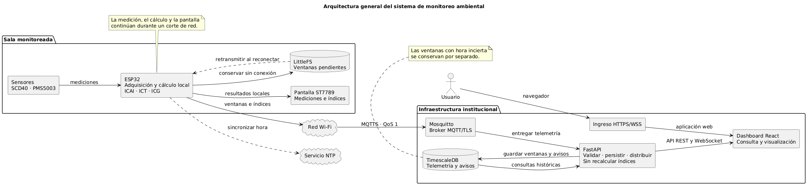

# Despliegue Kubernetes

Esta carpeta muestra un despliegue de referencia: almacenamiento, TimescaleDB, Mosquitto con **Dynamic Security**, API, web e Ingress. Los manifiestos usan el namespace genérico `aira` y el dominio reservado `aira.example.org`; sustitúyelo por el dominio propio antes de aplicar el Ingress. Los PVC usan la StorageClass predeterminada del clúster. Ningún nombre del despliegue identifica a una persona ni incluye credenciales.



## 1. Requisitos y revisión previa

Necesitas acceso `kubectl` al namespace, un controlador Ingress Nginx, almacenamiento persistente, DNS/TLS y permiso para crear Secret, PVC, ConfigMap, Deployment y Service. Revisa que las imágenes indicadas estén permitidas por el clúster. `timescale/timescaledb:latest-pg16` y `nginx:alpine` son tags móviles; registra y fija versiones/digests probados antes de una instalación reproducible. No subas kubeconfig, certificados privados, archivos `.env` ni datos productivos.

Comprueba el contexto con `kubectl config current-context`, crea el namespace con `kubectl create namespace aira` si falta y verifica que exista una StorageClass predeterminada con `kubectl get storageclass`. Si usarás otro namespace, cambia **todos** los `metadata.namespace` y los tres generadores de ConfigMaps antes de crear recursos. Si no hay StorageClass predeterminada, configura una existente en `01-storage.yaml` y revisa su capacidad. Sustituye `aira.example.org` en `06-ingress.yaml` por el dominio real del despliegue; no publiques ese valor ni el destino del DNS en este repositorio si son privados.

## 2. Secret y certificados fuera de Git

Prepara un archivo privado de variables **fuera del repositorio** con `POSTGRES_PASSWORD`, `JWT_SECRET_KEY` y `MQTT_INTERNAL_PASSWORD` de alta entropía. Añade `TELEGRAM_BOT_TOKEN` solo si habilitarás el bot; configura `PUBLIC_WEB_URL` con la URL HTTPS real para habilitar los botones «Ver sala» del bot. Crea `calidad-secrets` con tu gestor de secretos o `kubectl create secret generic calidad-secrets --from-env-file <RUTA_PRIVADA> -n aira`. Comprueba solo las **claves**, no imprimas valores en una terminal compartida.

El Ingress usa `calidad-tls-secret`. Crea ese Secret con el mecanismo TLS del clúster o `kubectl create secret tls calidad-tls-secret --cert <CERTIFICADO> --key <CLAVE_PRIVADA> -n aira`. La clave privada debe permanecer fuera de Git. El certificado que usa el ESP32 para verificar WSS debe corresponder a la cadena servida por el dominio.

## 3. Generar archivos derivados

Desde la raíz, instala `python -m pip install -r scripts/requirements.txt`; luego ejecuta `python scripts/generate_db_configmap.py` y `python scripts/generate_api_configmap.py`. Para la web entra en `web/`, ejecuta `npm ci` y `npm run build`, vuelve a la raíz y ejecuta `python scripts/generate_web_configmaps.py`. Los archivos `02-db-init.yaml`, `04-api-code.yaml`, `05-web-core.yaml` y `05-web-assets.yaml` se generan localmente y se ignoran en Git. Revisa los ConfigMaps antes de aplicarlos: no deben contener credenciales ni superar los límites de tamaño del clúster.

## 4. Primera instalación de una base vacía

Aplica en este orden, comprobando que cada Deployment esté disponible antes de continuar:

```powershell
kubectl apply -f k8s/01-storage.yaml
kubectl apply -f k8s/02-db-init.yaml
kubectl apply -f k8s/02-database.yaml
kubectl rollout status deployment/calidad-db -n aira
kubectl apply -f k8s/03-mqtt-config.yaml
kubectl apply -f k8s/03-mosquitto.yaml
kubectl rollout status deployment/calidad-mqtt -n aira
kubectl apply -f k8s/04-api-code.yaml
kubectl apply -f k8s/04-api.yaml
kubectl rollout status deployment/calidad-api -n aira
kubectl create -f k8s/05-web-core.yaml
kubectl create -f k8s/05-web-assets.yaml
kubectl create -f k8s/05-web-main-js.yaml
kubectl apply -f k8s/05-web.yaml
kubectl rollout status deployment/calidad-web -n aira
kubectl apply -f k8s/06-ingress.yaml
```

El SQL en `02-db-init.yaml` solo se ejecuta automáticamente cuando PostgreSQL inicializa un directorio de datos **vacío**. Sobre un PVC existente, aplicar el ConfigMap no cambia el esquema. Para una instalación existente, respalda, compara y aplica únicamente la migración necesaria según [`migrations/README.md`](migrations/README.md).

## 5. Verificar y operar

Para actualizar una web existente, genera los tres ConfigMaps desde el mismo build y usa `kubectl replace -f` para los tres. `kubectl apply` puede exceder el límite de anotaciones tanto en assets como en el JavaScript principal. Comprueba el éxito de cada reemplazo antes de reiniciar `calidad-web`; si falla uno, completa la actualización antes de publicar. Después del rollout, verifica que todos los archivos de `web/dist` existan con el mismo contenido en `/usr/share/nginx/html`, incluidos los módulos cargados al abrir login y las distintas páginas. La sonda de `/` por sí sola no detecta módulos JavaScript faltantes.

Revisa `kubectl get pvc,pods,svc,ingress -n aira`, los `rollout status` anteriores y el endpoint `/healthz` del API a través de la web (`/api/healthz`). Si el API no conecta al broker, revisa `calidad-secrets`, el `initContainer` de Mosquitto y la seguridad dinámica. Si la web sirve una versión anterior, reconstruye `dist`, regenera los ConfigMaps y reinicia el Deployment web de forma controlada. Nunca publiques logs con tokens o datos reales.

`04-api.yaml` monta firmware en `emptyDir` por una limitación original de cuota de PVC: al recrear el Pod se pierden esos archivos. Sustituye ese volumen por un PVC antes de depender de binarios alojados allí. Conserva respaldos de PostgreSQL y del estado del broker conforme a la política del operador. Para retirar o actualizar, haz primero un respaldo y revisa los cambios de PVC, Secret y migraciones; no reapliques indiscriminadamente el esquema inicial.
