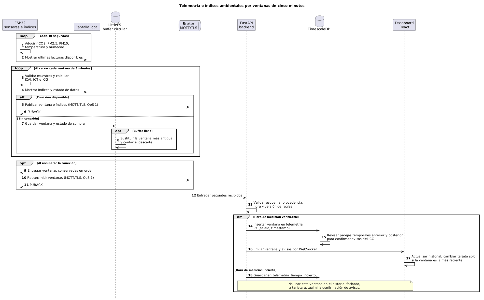

# Broker Mosquitto

El API consume `telemetria/+/datos`; cada nodo publica en `telemetria/<su-id>/datos` con QoS 1. La cuenta `api` y las credenciales de los nodos son distintas. La web expone el listener WebSocket a través de Nginx/Ingress para que el ESP32 use WSS.

## Dos configuraciones del repositorio

- [`mosquitto.conf`](mosquitto.conf) y [`aclfile`](aclfile) usan un archivo local de contraseñas y ACL. Sirven para pruebas aisladas del broker. Debes generar `password_file` **fuera de Git**, montarlo en `/mosquitto/runtime/password_file` y comprobar permisos del contenedor. Esta variante no proporciona la API de administración dinámica que usa el backend para crear credenciales de nodos.
- [`k8s/03-mqtt-config.yaml`](../k8s/03-mqtt-config.yaml) activa el plugin **Dynamic Security**. [`k8s/03-mosquitto.yaml`](../k8s/03-mosquitto.yaml) inicializa el usuario interno `api` desde el Secret y persiste `dynamic-security.json` en el PVC. Esta es la configuración que necesita el aprovisionamiento de nodos de la aplicación completa.

No mezcles los dos mecanismos en un mismo flujo de instalación. Para probar extremo a extremo usa la configuración Dynamic Security del [despliegue Kubernetes](../k8s/README.md), o monta localmente una configuración equivalente con plugin, usuario `api` y volumen persistente. Mantén fuera del repositorio `password_file`, `dynamic-security.json`, claves TLS y tokens de nodos.

## Comprobación en el clúster

1. Verifica que `calidad-secrets` contiene `MQTT_INTERNAL_PASSWORD` y que el PVC de Mosquitto está disponible.
2. Aplica primero `03-mqtt-config.yaml` y después `03-mosquitto.yaml`; espera `kubectl rollout status deployment/calidad-mqtt -n aira`.
3. Inicia el API con la misma contraseña interna mediante `MQTT_PASSWORD`. El API debe conectar y suscribirse a `telemetria/+/datos`.
4. Aprovisiona un nodo desde la web y comprueba en serie la conexión MQTT, la publicación y el `PUBACK`; después valida una nueva ventana en la base/web.

Si la conexión WSS falla, revisa por separado DNS, certificado, Ingress `/mqtt`, listener WebSocket 9001, identidad del nodo y hora NTP. Un `PUBACK` indica entrega al broker; la persistencia se verifica en el API y en PostgreSQL.
