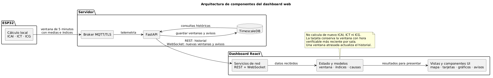
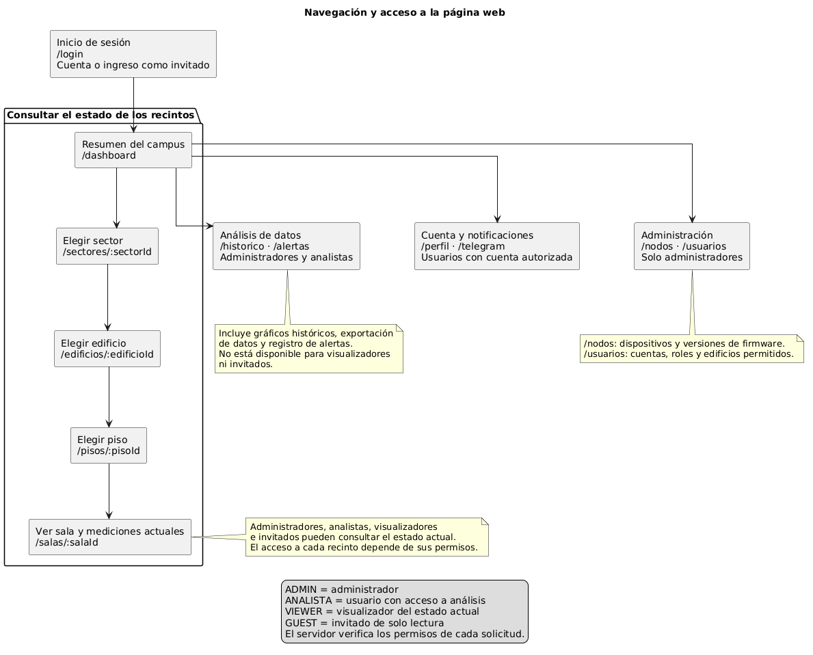
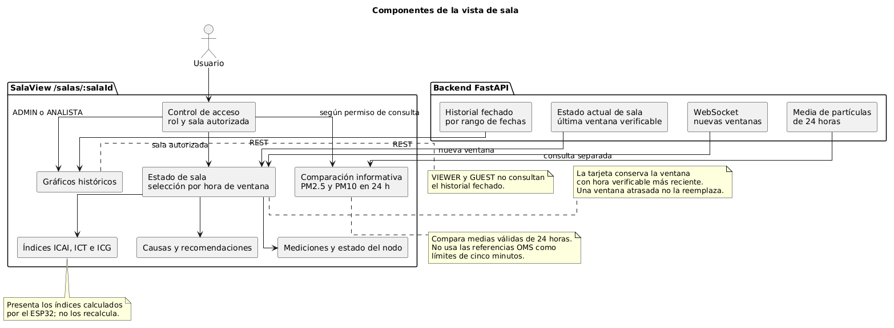

# Aplicación web

React 18 y Vite 5 presentan estado actual, jerarquía sector → edificio → piso → sala, nodos, alertas, historial según rol, usuarios, Telegram y carga de firmware ESP32 desde Web Serial. La pantalla de invitado solo muestra información actual. El código visual y funcional está en [`src/`](src/README.md); los [diagramas de arquitectura, rutas y componentes](docs/README.md) están junto a esta aplicación.

## Ejecutar y comprobar

1. Inicia la base y el API según la [instalación local](../docs/instalacion-local.md). Comprueba `http://127.0.0.1:8000/healthz` antes de abrir la web.
2. Desde `web/` ejecuta `npm ci`. Se necesita Node.js 20; el árbol de dependencias está en `package-lock.json`.
3. Ejecuta `npm run dev` y abre `http://localhost:5173`. Vite reenvía `/api` al puerto 8000 quitando el prefijo y `/ws` como WebSocket.
4. Entra como invitado para comprobar la vista pública, o con el primer ADMIN creado por `scripts/bootstrap_admin.py` para administrar. En una base nueva vacía debes crear la jerarquía antes de que aparezcan salas.
5. Ejecuta `npm run build` para validar y generar `dist/`. `dist/` es una salida local ignorada por Git. `npm run preview` permite revisar esa compilación.

## Firmware desde el navegador

La carga usa Web Serial: navegador compatible, HTTPS o localhost, cable USB de datos, placa ESP32 y permiso para el puerto. Selecciona una versión registrada, configura Wi‑Fi y sigue el log de conexión, escritura y confirmación del nodo. Mantén BOOT hasta que la placa sea detectada y el registro indique que puede soltarse; la escritura continúa sin mantenerlo. El navegador recibe una credencial temporal del API y no debe guardarla en archivos del proyecto. El [README del firmware](../esp32_nodo_aira/README.md) explica la placa, sensores y compilación.

## Despliegue y problemas frecuentes

`nginx.conf` sirve la SPA y reenvía `/api/`, `/ws` y `/mqtt` a los servicios del clúster. El `Dockerfile` compila con Node 20 y ejecuta Nginx; los manifiestos Kubernetes actuales sirven los archivos desde ConfigMaps generados después de `npm run build`. Si una ruta muestra HTML en vez de JSON, revisa el proxy; si el estado no cambia en vivo, revisa `/ws`; si Web Serial no aparece, revisa navegador, contexto seguro y permisos USB. No publiques `dist/`, tokens de sesión ni credenciales de Wi‑Fi.
